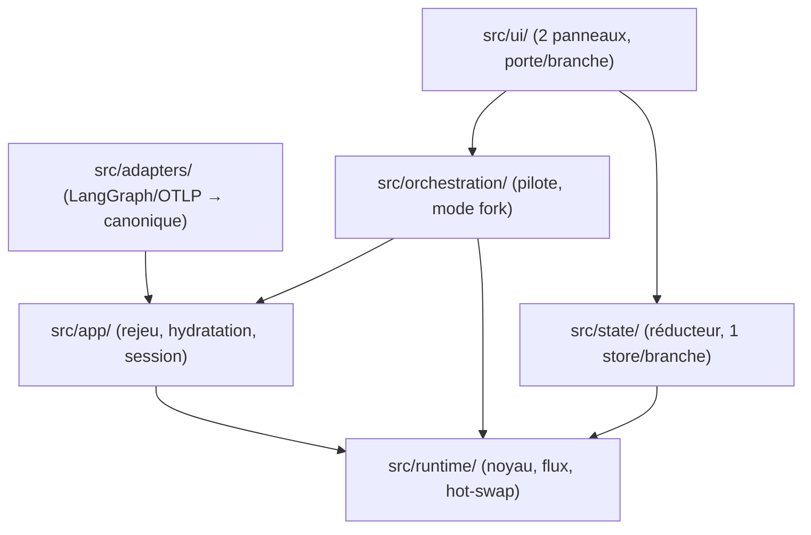

# Architecture Spine — Fork de timeline (atelier de pré-prod)

## Design Paradigm

**Event-sourcing à projections divergentes.** Une trajectoire est un **flux
d'événements immuable**. Le rejeu réduit ce flux dans un **modèle de lecture**
(réutilisé tel quel du produit). Un **fork** est une nouvelle projection qui
partage le préfixe `[1..N]` du flux, puis **diverge** : la branche ré-exécute à
partir de N et enregistre *son propre* flux. Tronc et branche sont deux
projections d'un même préfixe, jamais deux copies d'un même enregistrement.

Correspondance aux namespaces (réutilise l'existant, une seule frontière neuve) :

- `src/adapters/` **(neuf)** — la seule frontière qui connaît un format étranger
  (LangGraph, OTLP) ; il traduit vers le flux canonique. Rien d'autre ne
  l'importe.
- `src/runtime/` — le noyau (cordis), le flux `RunEvent`, le hot-swap réversible.
- `src/orchestration/` — le pilote ; gagne un **mode fork** (rejoué-puis-vivant).
- `src/state/` — le réducteur pur ; **un store par branche**.
- `src/app/` — rejeu, hydratation, session (hors du remplaçable).
- `src/ui/` — la scène à **deux panneaux** divergents, une porte par branche.

## Inherited Invariants

Hérités de la spine produit (`architecture-usine-2026-08-20`), **read-only**,
non renumérotés, non re-dérivés. Une décision locale qui les contredit est un
conflit à remonter, pas une dérogation.

| Inherited | From parent | Binds here |
| --- | --- | --- |
| AD-30 | spine produit | L'état vit hors de tout ce qui est remplaçable → deux branches divergent sans se contaminer. |
| AD-31 | spine produit | Un remplacement prend ou rend la main ; l'échec restaure la version précédente avec ses enfants → base du hot-swap sur branche. |
| AD-33 | spine produit | Un run est rejouable depuis son seul flux ; `at` élapsé, jamais de date absolue → base du rejeu jusqu'à N et de l'enregistrement de la branche. |

## Invariants & Rules

### AD-35 — Une trace externe n'entre que par un adaptateur, vers un flux canonique

- **Binds:** import, `src/adapters/`
- **Prevents:** coupler l'atelier à un format fournisseur ; disséminer la
  connaissance de LangGraph/OTLP dans le noyau.
- **Rule:** tout import traverse un **schéma canonique interne** (`AgentTrace` →
  flux d'événements). L'adaptateur est la **seule** unité qui connaît un format
  étranger, et la **seule exception** au minage runtime-only : il **assigne les
  `sequence` du préfixe** à l'import (une trace étrangère n'en porte pas). Il
  distingue explicitement une **trace** (observabilité, lecture seule → sert le
  tronc) d'un **checkpoint reprenable** (état vivant → nécessaire à une
  ré-exécution étrangère, cf. AD-37). `[ASSUMPTION]` premier adaptateur =
  **LangGraph** (traces LangSmith / état de checkpointer), OTLP ensuite mais
  **tronc seulement** (les spans ne portent pas d'état reprenable).

### AD-36 — Le point de fork est un `sequence` du flux ; le préfixe est immuable

- **Binds:** fork, rejeu
- **Prevents:** des forks ambigus ou non reproductibles ; une branche qui
  réécrirait le passé.
- **Rule:** on forke à un événement **N adressable par `sequence`**. Le préfixe
  `[1..N]` est **partagé et immuable** entre tronc et branche ; personne ne le
  mute après coup.

### AD-37 — Le tronc est une lecture ; la branche est une exécution

- **Binds:** fork, divergence
- **Prevents:** la fiction que la branche est le même enregistrement que le
  tronc, ou qu'elle serait identique au rejeu.
- **Rule:** le **tronc** rejoue une trace importée (un *recording* immuable,
  visualisation seule, sans kernel — cf. AD-48). La **branche** **ré-exécute** à
  partir de N avec l'élément modifié, et **s'enregistre elle-même** en flux dès
  son premier pas (AD-33) — donc rejouable *après coup*, jamais identique au
  tronc. L'UI nomme cette asymétrie (recording vs exécution neuve).
  **Chemin v1 (buildable) :** la branche ré-exécute des **comportements maison**
  (leur source est dans le flux) via le hot-swap réversible existant (AD-31) sur
  un kernel hydraté (AD-49). **Re-exécuter un agent étranger** (LangGraph) exige
  un checkpoint reprenable + graphe + outils + un runner à réseau ouvert — un
  substrat distinct du Worker (dont le réseau est retiré, AD-29) et soumis à
  AD-41 pour les effets externes : c'est en **Deferred**, pas la règle v1.

### AD-38 — Deux branches, deux modèles de lecture isolés

- **Binds:** coexistence tronc/branche
- **Prevents:** la contamination d'état entre deux futurs ; un compteur d'une
  branche gonflé par l'autre.
- **Rule:** chaque branche possède **son store, son kernel, sa session** ; aucun
  singleton partagé. Les états d'exécution partagés par processus (télémétrie,
  capacité relais) sont **cloisonnés par branche**. L'état du visiteur vit hors
  du remplaçable (AD-30).

### AD-39 — La porte décide d'une branche, pas d'un run

- **Binds:** porte humaine
- **Prevents:** valider ou rejeter globalement ce qui n'est vrai que d'une
  branche.
- **Rule:** **chaque branche porte sa porte** (valide / rejette *cette*
  branche). Rejeter défait la branche avec rétractation visible ; le tronc et
  les autres branches restent intacts.

### AD-40 — La comparaison est mesurée, jamais affirmée

- **Binds:** « quelle branche est meilleure »
- **Prevents:** un jugement à l'œil, une préférence codée en dur.
- **Rule:** la comparaison **diffe deux `RunMeasure`** (`evaluation.py`
  `measure(archive) -> RunMeasure`) entre tronc et branche — pas `Report`, qui
  est un **agrégat de population** (n>1) et dégénère à n=1. Aucune branche n'est
  déclarée gagnante autrement que par cet écart mesuré. **Contrainte connue :**
  un tronc importé ne porte pas nos événements de cycle de vie ; l'adaptateur
  doit les mapper vers le vocabulaire mesurable (`component-created`,
  `screen-posted`, `behaviour:`…) sinon `measure` renvoie des zéros — à traiter
  à l'implémentation de l'adaptateur.

### AD-41 — Le périmètre du rollback est dit, pas caché [ADOPTED]

- **Binds:** tout le fork, l'UI
- **Prevents:** laisser croire qu'un effet externe (base supprimée, e-mail parti,
  virement) serait annulable.
- **Rule:** la réversibilité est **intra-runtime**. Une action à effet externe
  irréversible se **prévisualise sous porte** (prévenir avant), elle ne
  s'annule pas après. L'atelier se présente comme une **primitive**
  (réversibilité + fork visuel), jamais comme une « plateforme de fiabilité » ni
  un « control plane ».

### AD-42 — Une trace importée est une donnée hostile

- **Binds:** `src/adapters/`, import
- **Prevents:** faire confiance à une trace étrangère (taille, forme, contenu).
- **Rule:** toute trace importée est **validée et normalisée** (à l'image de
  `readArchive`) : borne de taille, champs vérifiés, un champ hors forme fait
  **rejeter, pas deviner**. Aucune adresse/donnée fournie par la trace n'est
  suivie comme instruction.

### AD-43 — `branchId` est minté par le runtime, opaque, indépendant de N

- **Binds:** identité de branche
- **Prevents:** deux unités qui mintent des `branchId` incompatibles (UUID vs
  `branch@N`), et des collisions entre deux branches forkées au même N.
- **Rule:** le **runtime** est le seul à minter un `branchId` ; sa forme est
  **opaque** et **indépendante de `sequence`/N**. Deux forks au même N ont deux
  `branchId` distincts.

### AD-44 — Après le fork, la clé d'un événement est `(branchId, sequence)`

- **Binds:** flux, rejeu (précise AD-33 dans le contexte du fork)
- **Prevents:** des `sequence` qui se chevauchent entre tronc, préfixe et
  branches (chaque kernel recompte à partir de 1), rendant les archives
  mutuellement irrejouables.
- **Rule:** un événement post-fork est identifié par **`(branchId, sequence)`**,
  pas par `sequence` seul. Le **premier** événement d'une branche est un
  `branch-forked` qui porte `{trunkId, N}` — référencer un *recording* immuable
  par id + N est **permis** (nuance à AD-33, qui interdit de référencer un objet
  *vivant*). C'est ce qui rend l'archive d'une branche auto-descriptive.

### AD-45 — Seul le tableau d'événements du préfixe est partagé ; chaque branche le ré-réduit

- **Binds:** préfixe partagé (concilie AD-36 et AD-38)
- **Prevents:** partager un *read model* vivant entre branches (fuite d'état,
  violation d'AD-30/AD-38) ou, à l'inverse, recopier tout le flux par branche.
- **Rule:** « partagé » (AD-36) veut dire que le **tableau d'événements
  `[1..N]`** est partagé et immuable ; chaque branche **re-réduit** ce préfixe
  dans **son propre** read model. Aucun read model réduit n'est jamais partagé
  comme objet vivant.

### AD-46 — Le temps de la branche est élapsé-depuis-le-fork, avec un offset enregistré

- **Binds:** axe temps des deux panneaux (précise AD-33)
- **Prevents:** deux axes de temps désalignés (le kernel de branche remet `at` à
  ~0 au fork), rendant la divergence et la comparaison illisibles.
- **Rule:** le `at` d'un événement de branche est **élapsé depuis le fork** ; le
  `branch-forked` (AD-44) enregistre l'**offset** du fork sur l'axe du tronc.
  L'UI aligne les deux panneaux via cet offset.

### AD-47 — Rejeter une branche est un teardown entier, distinct du rollback d'AD-31

- **Binds:** porte (précise AD-39 vs AD-31 hérité)
- **Prevents:** implémenter le rejet de branche comme une cascade de restaurations
  de composants (AD-31), qui laisse fuir le kernel/store/session de la branche.
- **Rule:** rejeter une branche **défait la branche entière** (kernel + store +
  session), pas seulement ses composants. AD-31 (restaurer une version
  précédente avec ses enfants) reste réservé à l'échec d'un *remplacement*.

### AD-48 — Le tronc est un recording sans kernel, pas une branche

- **Binds:** tronc vs branche (lève l'ambiguïté AD-37 / AD-38)
- **Prevents:** modéliser le tronc en « branche 0 » avec un kernel et tenter de
  le ré-exécuter, contre AD-37.
- **Rule:** le **tronc** est un **store sans kernel** (rejeu d'un recording,
  AD-37) ; il n'est **pas** une branche. Seules les branches ont un kernel
  (AD-38). Le registre de branches et le contrat des deux panneaux le traitent
  comme un genre distinct.

### AD-49 — Une branche naît d'un kernel hydraté depuis le préfixe

- **Binds:** fork, hot-swap (le mécanisme neuf load-bearing)
- **Prevents:** un `kernel.replace` (AD-31) sans cible — aujourd'hui
  `behavioursFromArchive` reconstruit des comportements *sans* kernel.
- **Rule:** forker matérialise un **kernel vivant** en ré-instanciant, depuis le
  préfixe `[1..N]`, les composants **vivants à N**, avec leur **identité et leur
  parentage** restaurés — pour que la garantie d'AD-31 (« restaurer la version
  précédente **avec ses enfants** ») tienne encore sur la branche. C'est le seul
  substrat réellement neuf ; tout le reste est du câblage additif.

### Dépendances (qui peut dépendre de qui)



## Consistency Conventions

| Concern | Convention |
| --- | --- |
| Nommage | Code en anglais (identifiants, fichiers, tests, événements, classes CSS) ; libellés d'interface, narration et invites modèle en français. |
| Événements | Le flux canonique réutilise/étend `RunEvent`. Clé d'un événement post-fork : `(branchId, sequence)` (AD-44) ; `branchId` opaque minté par le runtime (AD-43) ; le fork adressé par le `sequence` N (AD-36) ; `at` de branche élapsé-depuis-le-fork + offset (AD-46). |
| Donnée hostile | Toute entrée externe (trace importée, réponse de service) est relue et validée avant usage ; échec → rejet silencieux, jamais rendu partiel deviné. |
| État / transverse | Un store/kernel/session par branche (AD-38) ; l'état du visiteur hors du remplaçable (AD-30) ; télémétrie et capacité relais cloisonnées par branche. |

## Stack

SEED — vérifié au moment de l'écriture ; le code en devient propriétaire.

| Name | Version |
| --- | --- |
| Vue 3 / TypeScript / Vite | (réutilisé, cf. spine produit) |
| Cordis (`@cordisjs`) | (réutilisé — noyau de composition) |
| services/api (FastAPI) | (réutilisé — éval, tracing, runs) |
| Adaptateur LangGraph → canonique | `[ASSUMPTION]` premier format ; à figer à l'implémentation |

## Structural Seed

```text
src/
  adapters/          # NEUF — trace externe → flux canonique (seule frontière fournisseur)
    agent-trace.ts   # le schéma canonique interne
    langgraph.ts     # [ASSUMPTION] premier adaptateur
  app/
    replay.ts        # rejeu jusqu'à N (ajout d'un stopAt), hydratation
    fork.ts          # NEUF — matérialise une branche vivante au point N
  orchestration/
    pilot.ts         # + mode fork (rejoué-puis-vivant), expose tronc + branche
  state/             # 1 store par branche
  ui/                # scène deux panneaux, une porte par branche, bandeau de comparaison
```

## Capability → Architecture Map

| Capability / Area | Lives in | Governed by |
| --- | --- | --- |
| Importer une trace externe | `src/adapters/` | AD-35, AD-42 |
| Rejouer jusqu'à N | `src/app/replay.ts` | AD-33, AD-36 |
| Forker + ré-exécuter la branche | `src/app/fork.ts`, `src/orchestration/pilot.ts` | AD-31, AD-36, AD-37, AD-38 |
| Deux futurs côte à côte | `src/ui/`, `src/state/` | AD-38 |
| Porte par branche | `src/ui/`, `src/runtime/` | AD-39 |
| Quelle branche est meilleure | `services/api/.../evaluation.py`, `src/ui/` | AD-40 |
| Honnêteté du périmètre | `src/ui/`, positionnement | AD-41 |

## Deferred

- **Quel format externe en premier** (LangGraph vs OTLP vs schéma générique) —
  `[ASSUMPTION]` LangGraph ; à confirmer avant d'écrire l'adaptateur.
- **Runner de ré-exécution d'agents étrangers** (AD-37) : re-exécuter un agent
  LangGraph depuis N exige un **checkpoint reprenable** (pas une trace
  d'observabilité), le graphe, les outils, le modèle, et un **environnement à
  réseau ouvert** distinct du Worker (AD-29) et gated par le relais (AD-34) —
  soumis à AD-41 pour les effets externes. C'est le chantier lourd. **v1 démarre
  par la ré-exécution de comportements maison** (source dans le flux) comme
  preuve ; les frameworks tiers viennent après. OTLP reste **tronc seulement**.
- **Compensation d'effets externes** (sagas / undo réel hors runtime) — hors
  périmètre (AD-41) ; à nommer, pas à bâtir maintenant.
- **Garanties de déterminisme de la branche** au-delà de « enregistrée donc
  rejouable après coup » — non promis.
- **Tenue à l'échelle** (dizaines de nœuds vivants × deux branches) — non prouvée.
- **Détail de mise en page des deux panneaux** — appartient à la spine produit /
  `DESIGN.md`, pas ici.
