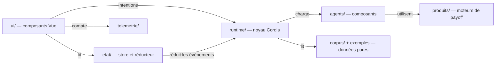
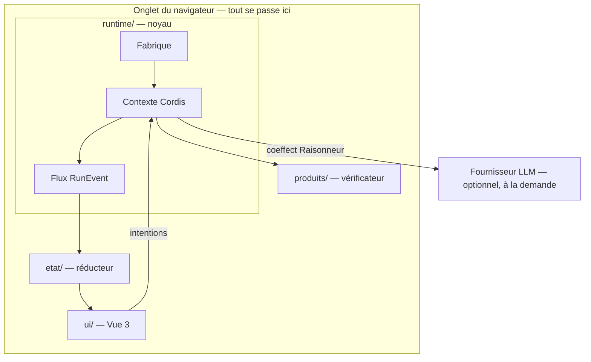
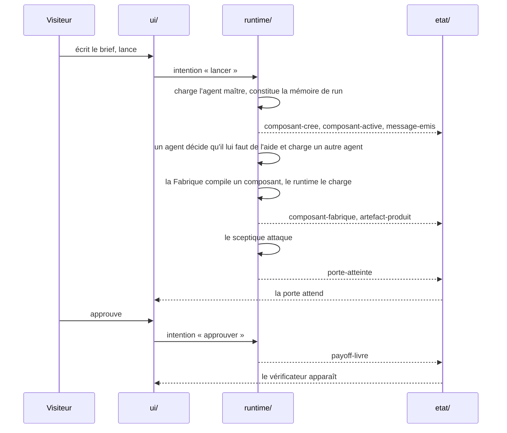
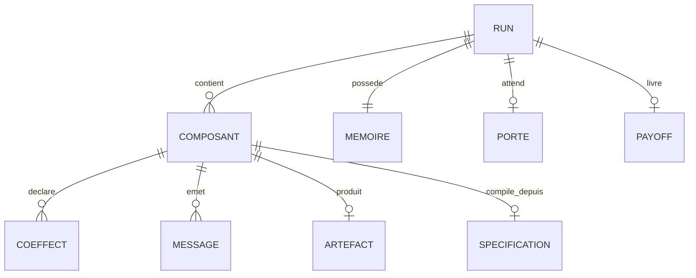
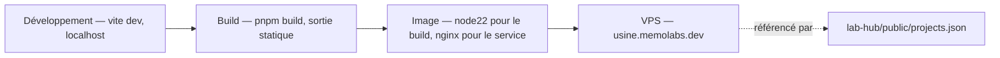

# Architecture Spine — L'usine agentique

## Design Paradigm

**Noyau de composition + projection unidirectionnelle** — des ports et adaptateurs autour du runtime Cordis.

Le runtime est le cœur : c'est lui qui charge les composants, propage les coeffects, fabrique et révoque. Il ne connaît ni Vue, ni le DOM, ni le domaine. Tout ce que le reste du monde apprend de lui sort par un **flux d'événements typés**, réduit dans un **modèle de lecture** que l'interface se contente d'afficher.

Le sens de la dépendance ne s'inverse jamais. L'interface pose des **intentions** (lancer, approuver, écarter, brancher un modèle) ; elle ne touche jamais une fiber.



Correspondance couche / répertoire : le paradigme est appliqué par l'arborescence, et l'arborescence est appliquée par le lint (AD-2).

## Invariants & Rules

### AD-1 — Le runtime est la seule source de vérité du run

- **Binds:** all
- **Prevents:** que l'interface et le moteur deviennent deux propriétaires du même état, et que le graphe affiche autre chose que ce qui vit réellement
- **Rule:** aucun état de run n'existe hors du runtime et de sa projection. Un nœud affiché correspond à une fiber vivante ; une arête affichée correspond à un coeffect réel. La contre-métrique C3 du PRD est vérifiée par un test automatisé qui compare les deux ensembles.

### AD-2 — Seul `runtime/` importe `cordis`

- **Binds:** all
- **Prevents:** que des appels au moteur se dispersent dans les composants Vue et que le paradigme s'érode composant par composant
- **Rule:** l'import de `cordis` est interdit partout ailleurs, par règle ESLint `no-restricted-imports` et non par discipline. Les autres modules passent par l'API publique de `runtime/`.

### AD-3 — Canal unique : tout sort en `RunEvent`

- **Binds:** F2, F3, F4, F8, F10
- **Prevents:** deux chemins concurrents de mise à jour, et des rappels ad hoc qui contournent la projection
- **Rule:** `runtime/` expose un unique flux d'`RunEvent`, union discriminée sur `type`. Ajouter une information visible au run, c'est ajouter une variante à cette union — jamais un rappel, jamais une lecture directe du registre.

### AD-4 — Le store n'est écrit que par le réducteur

- **Binds:** F3, F4, F8, F10
- **Prevents:** deux propriétaires d'une même donnée, et des mutations depuis un composant d'affichage
- **Rule:** `etat/` expose un état en lecture seule et une seule fonction d'écriture, le réducteur `(etat, RunEvent) => etat`. Aucun composant Vue ne mute l'état. Le réducteur est pur et testable hors navigateur.

### AD-5 — Le graphe est une projection, jamais une source

- **Binds:** F3
- **Prevents:** le nœud décoratif que FR-016 interdit et que la contre-métrique C6 traque
- **Rule:** aucun code d'interface ne crée un nœud, une arête ou un état de nœud. Tout provient du réducteur. Une animation qui n'exprime aucun `RunEvent` est un défaut, pas une finition.

### AD-6 — Contrat de composant unique, présentation comprise

- **Binds:** F2, F3, F11
- **Prevents:** que les agents et les outils divergent en deux familles, et que l'affichage invente des métadonnées
- **Rule:** agents et outils partagent un seul type `Composant` : `name`, `inject`, `provide`, `apply`, plus un bloc `presentation` (rôle en une ligne, technologie **effective**). La technologie n'est renseignée que si le composant l'exécute réellement (FR-057) ; sinon le champ reste vide et rien ne s'affiche.

### AD-7 — L'identité appartient au runtime

- **Binds:** F2, F3, F10
- **Prevents:** deux schémas d'identifiants, et des nœuds orphelins après un rechargement
- **Rule:** l'identifiant d'un composant dérive de sa fiber, produit par `runtime/`. Aucun autre module ne fabrique d'identifiant de composant. Les artefacts et les messages référencent cet identifiant.

### AD-8 — Un agent écrit le code de son outil, et ce code est évalué

*Renversé. La version initiale interdisait l'évaluation par défaut et passait par un port `Fabrique` à deux voies, dont l'une n'assemblait qu'un vocabulaire fermé. Un agent ne pouvait donc jamais produire un outil imprévu — c'était le plafond, pas une sécurité.*

- **Binds:** F11
- **Prevents:** qu'un outil « fabriqué » ne soit en réalité qu'une combinaison choisie dans un catalogue écrit d'avance
- **Rule:** l'outil d'un agent est du **code que le modèle écrit**, évalué (`new Function`) et chargé à chaud comme n'importe quel composant. L'évaluation est cantonnée à **un seul fichier** (`agents/libre.ts`), et une règle ESLint la refuse partout ailleurs — vérifiée par un test qui exécute le linter. Ce qui protège n'est pas l'interdiction d'évaluer : c'est que le code est **affiché avant de tourner**, que la **porte humaine** reste devant la livraison, et que la page ne porte ni secret ni donnée de visiteur.

### AD-9 — Le LLM est un adaptateur derrière le port `Raisonneur`

- **Binds:** F7, F2
- **Prevents:** des appels au modèle dispersés dans les agents, et un repli d'erreur réimplémenté à chaque endroit
- **Rule:** un agent ne parle jamais à un fournisseur. Il consomme le coeffect `Raisonneur`. L'implémentation déterministe est le défaut ; l'adaptateur LLM la remplace agent par agent. En cas d'échec (clé, quota, réseau), le port retombe sur l'implémentation déterministe et émet un `RunEvent` d'erreur — le repli exigé par FR-046 est mécanique, pas répété.

### AD-10 — Le casting est un résultat du brief, pas une déclaration

*Révisé. La version initiale faisait du scénario une donnée déclarant le casting complet ; c'était une chaîne connue d'avance dont le brief ne changeait rien. Voir AD-23 et AD-24.*

- **Binds:** F9, F1, F6
- **Prevents:** qu'un graphe connu d'avance se fasse passer pour une composition, et des branchements conditionnels par niche dans le moteur
- **Rule:** aucun fichier ne déclare quels agents existent. Un **plan** est produit à l'exécution à partir du brief (AD-23) et le maître le charge (AD-24). Ce qui reste déclaré est de la **donnée métier** : les corpus de règles (`src/corpus/`), que l'usine choisit et n'invente pas, et des briefs d'exemple (`src/exemples.ts`) qui ne décrivent aucun graphe. Ajouter une niche, c'est ajouter un corpus — aucun fichier de moteur, aucune topologie.

### AD-23 — Un agent n'a pas de comportement, il a une boucle d'actions

*Remplace la version « plan vérifié avant chargement ». Un plan décidé au départ restait un graphe connu d'avance : plus court, mais connu.*

- **Binds:** F1, F9, F10
- **Prevents:** qu'un catalogue d'agents écrits à la main se fasse passer pour une composition, et qu'une réponse de modèle atteigne le moteur sans être reconstruite
- **Rule:** un agent est une **mission** et une **boucle** : le modèle rend des actions (`creer`, `demander`, `fabriquer`, `publier`, `retirer`, `dire`, `terminer`), le moteur les exécute et lui rend les observations. Aucun rôle, aucun nom, aucune dépendance n'est écrit dans le produit. Ce qui vient du modèle est **reconstruit champ par champ** avant exécution (`agents/actions.ts`) — une action illisible est écartée, le tour continue. Sans modèle, aucun agent ne naît : l'usine ne peut rien inventer, et l'écran le dit plutôt que de rejouer un catalogue.

### AD-24 — Ce qui borne un run est un budget, pas un catalogue

- **Binds:** F1, F3, F11
- **Prevents:** qu'un chantier récursif parte à l'infini, et qu'un agent en panne fige le run sans écran
- **Rule:** quatre bornes, portées par le chantier partagé : nombre d'agents, profondeur de création, tours par agent, tokens du run. Un dépassement est une **observation rendue à l'agent** (« refusé : profondeur maximale atteinte »), pas une exception. Le maître n'ouvre la porte humaine qu'une fois le chantier **stabilisé** — plus aucun composant actif et aucune apparition pendant plusieurs vérifications — ou le délai écoulé, et il le dit. La porte reste hors du champ des agents : un produit qui pourrait se livrer sans décision humaine ne serait plus le même produit.

### AD-25 — Les agents se parlent par un aller-retour explicite

- **Binds:** F2, F3
- **Prevents:** qu'« ils se parlent » soit raconté par la narration sans exister dans le moteur
- **Rule:** les coeffects ne vont que dans un sens. La conversation est un mécanisme distinct : `ecouter` déclare comment un composant répond, `demander(nom, question)` route vers lui et attend, borné dans le temps. Une question et sa réponse sont **deux événements** (`question-posee`, `reponse-donnee`), donc deux faits vérifiables et deux traces à l'écran. Un destinataire absent, muet ou trop lent rend `undefined` — un silence, jamais une panne du demandeur.

### AD-26 — Un composant ne défait que ce qu'il a fait

- **Binds:** F2, F10
- **Prevents:** qu'un agent retire son propre maître, ou un pair qu'il n'a pas créé, et que le run se déferre par le milieu
- **Rule:** `liberer` et `remplacer` existent dans le contexte d'un composant, mais **refusent tout identifiant dont il n'est pas le parent**. La filiation est portée par le runtime, jamais déclarée par l'agent. Elle est aussi rendue visible : une arête de filiation relie créateur et créé quand aucun flux de données ne les relie déjà.

### AD-11 — La disposition suit la topologie vivante, et ne se recalcule que quand elle change

*Révisé. La version initiale calculait la disposition une fois sur la topologie déclarée ; elle supposait un graphe connu avant le run, ce qui n'est plus le cas.*

- **Binds:** F3, F9, F11
- **Prevents:** qu'un nœud vivant n'ait aucune place, que la disposition se recalcule à chaque message, et que deux runs de même topologie ne se ressemblent pas
- **Rule:** la disposition est calculée sur les **nœuds et arêtes réellement vivants**, et recalculée **au seul changement de topologie** — une signature `noms + arêtes` en décide ; ni un état, ni un artefact, ni un message ne déplace quoi que ce soit. Les nœuds **glissent** vers leur nouvelle place, la transition étant neutralisée sous `prefers-reduced-motion`. L'ordre interne d'une couche vient de l'ordre d'apparition. Le graphe est tenu entier dans son cadre par un `viewBox` : sa taille n'est pas connue d'avance. Le calcul de coordonnées s'appuie sur `@dagrejs/dagre` ; le **rendu** reste du code du projet, en SVG.

### AD-12 — Le vérificateur est une fonction pure

- **Binds:** F6
- **Prevents:** la dérive du déterminisme exigé par FR-039, et un verdict qui dépendrait du moment où il est calculé
- **Rule:** le moteur de règles n'a ni horloge, ni aléatoire, ni entrée/sortie. Il prend un texte et un jeu de règles, il rend des verdicts sourcés. En l'absence de règle applicable, il rend « à vérifier » — jamais un verdict tranché (FR-038).

### AD-13 — Aucun secret persisté

- **Binds:** F7
- **Prevents:** une clé qui survit à l'onglet et fuit par le stockage du navigateur
- **Rule:** la clé d'API vit dans une variable de module. Jamais `localStorage`, jamais `sessionStorage`, jamais un cookie, jamais un journal. Elle ne sort que vers le fournisseur sélectionné.

### AD-14 — Télémétrie fermée à quatre appels

- **Binds:** F8
- **Prevents:** qu'un contenu saisi par l'utilisateur parte par inadvertance, ce que NFR-011 interdit
- **Rule:** un module unique expose exactement quatre fonctions sans paramètre libre : `runLance`, `porteAtteinte`, `payoffAffiche`, `verificationSoumise`. Aucune charge utile, aucun identifiant, aucun cookie. Tout autre besoin de mesure passe par une décision, pas par un ajout silencieux.

### AD-15 — Un échec est un événement, pas une exception

- **Binds:** F2, F3, F4
- **Prevents:** qu'un agent défaillant fasse tomber la démonstration devant un recruteur
- **Rule:** `runtime/` capture les erreurs d'activation et les convertit en `RunEvent` d'erreur. Le run continue, le nœud porte l'état d'erreur, ses dépendants restent en attente et le signalent (FR-014).

### AD-16 — La politique de sécurité est un invariant de déploiement, `unsafe-eval` compris

*Renversé en même temps qu'AD-8, et pour la même raison. Ce qui était « pas d'`unsafe-eval` » est devenu « `unsafe-eval` et rien d'autre ».*

- **Binds:** all
- **Prevents:** que la politique s'élargisse au-delà de ce que l'évaluation exige réellement
- **Rule:** la production sert `default-src 'self'` et `script-src 'self' 'unsafe-eval'` — l'évaluation est nécessaire (AD-8), aucune source de script externe ne l'est. Le reste ne bouge pas : `object-src`, `frame-src`, `base-uri`, `form-action`, `frame-ancestors` à `'none'`, `connect-src` limité à `'self'` et au fournisseur du mode branché. Deux tests le tiennent : un test de contrat qui lit le fichier nginx servi, et un test en navigateur réel qui exécute un outil écrit pendant le run et vérifie qu'aucune requête ne part.

### AD-17 — Un nom de coeffect a un propriétaire unique, déclaré

- **Binds:** F2, F9, F11
- **Prevents:** que deux composants fournissent le même nom de coeffect et qu'un agent se câble au hasard sur l'un ou l'autre
- **Rule:** chaque nom de coeffect a un fournisseur unique. Le plan le déclare — et sa vérification (AD-23) refuse un nom publié deux fois ou un nom appartenant au maître. Charger un second fournisseur pour un nom déjà pris est une erreur de chargement, pas un remplacement silencieux — le runtime la convertit en `RunEvent` d'erreur (AD-15).

### AD-18 — Un composant produit au plus un artefact final

- **Binds:** F10
- **Prevents:** que deux constructeurs émettent plusieurs artefacts et que l'interface doive deviner lequel afficher quand on clique sur un nœud
- **Rule:** un composant émet autant de versions qu'il veut ; le réducteur ne conserve que la dernière, indexée par `IdComposant`. « L'artefact d'un nœud » est donc toujours défini et unique. Un artefact partagé par plusieurs composants n'existe pas : il appartient à celui qui l'a émis, et les autres le citent par l'identifiant de son auteur.

### AD-19 — L'état affiché d'un nœud est dérivé, jamais déclaré

- **Binds:** F3, F2
- **Prevents:** que chaque agent invente sa propre notion de « terminé » et que deux nœuds au même état réel s'affichent différemment
- **Rule:** les états visibles (inactif, en attente de dépendance, en cours, terminé, en erreur, libéré) sont produits par une **fonction unique** dans `etat/`, à partir du `FiberState` du runtime et des événements reçus. `FiberState` ne connaît pas « terminé » : c'est le composant qui émet `travail-termine` quand il a fini, et seule cette fonction traduit. Aucun composant ne pousse un état d'affichage.

### AD-20 — Les événements portent une séquence monotone produite par le runtime

- **Binds:** F3, F4, F8, F10
- **Prevents:** que des agents en parallèle rendent l'ordre d'affichage non reproductible, et que deux endroits se disputent la ligne de narration
- **Rule:** chaque `RunEvent` porte un numéro de séquence strictement croissant, attribué par `runtime/`. La ligne de narration (FR-026) est une **dérivation du réducteur** : le message de plus haute séquence, point. Aucun composant d'interface ne décide de ce qui s'affiche dans la narration.

### AD-21 — *(retirée)* Le registre de primitives de fabrication

*Supprimée avec AD-8. Le registre était le vocabulaire fermé dans lequel un agent devait puiser ; il n'existe plus, les agents écrivent leur code.*


### AD-22 — L'accessibilité est un invariant de rendu, pas une finition

- **Binds:** F3, F4, F5, F6
- **Prevents:** que chaque unité d'affichage arbitre l'accessibilité à sa façon et qu'un état de nœud finisse porté par la seule couleur
- **Rule:** trois règles s'appliquent à tout élément qui exprime un état : il porte une forme ou un texte en plus de sa couleur (NFR-017), il est atteignable au clavier s'il est actionnable (NFR-016), et son animation est neutralisée sous `prefers-reduced-motion` sans que l'information disparaisse (NFR-018). Les états de nœud sont rendus par un composant unique — pas réimplémentés par vue.

## Consistency Conventions

| Concern | Convention |
| --- | --- |
| Langue du code | Identifiants et noms de fichiers en français, comme le domaine (`composant`, `fabrique`, `verificateur`). Les termes du runtime Cordis restent en anglais (`fiber`, `inject`, `provide`, `effect`) : ce sont des noms d'API, pas du vocabulaire métier. |
| Nommage des fichiers | `kebab-case.ts` pour les modules, `PascalCase.vue` pour les composants Vue, un fichier par composant Cordis sous `agents/`. |
| Événements | `RunEvent` discriminé sur `type`, valeurs en `kebab-case` (`composant-active`, `artefact-produit`, `porte-atteinte`). Passé composé : un événement décrit un fait accompli. |
| Identifiants | `IdComposant` est un type nominal produit par `runtime/`. Jamais une chaîne nue dans une signature publique. |
| Dates et durées | Millisecondes entières pour les durées ; aucune date absolue dans le modèle de run. |
| Ordre | Tout ordre visible dérive du numéro de séquence des événements (AD-20) : ordre d'apparition dans une couche du graphe, ordre du journal. Jamais un tri par date. |
| Forme d'erreur | `{ code: string, message: string, composant?: IdComposant }`. Jamais une `Error` brute franchissant la frontière du runtime. |
| Mutation d'état | Une seule voie : le réducteur. Les composants Vue reçoivent des valeurs, émettent des intentions. |
| Journalisation | Aucune sortie console en production. Le journal du run (NFR-014) est une projection du flux d'événements, pas un `console.log`. |
| Configuration | Aucune variable d'environnement dans le chemin par défaut : l'application doit fonctionner servie telle quelle. |
| Types | TypeScript strict, aucun `any` implicite, aucune assertion `as` sur une frontière de module. |

## Stack

Versions relevées sur le registre npm le 2026-08-20.

| Name | Version |
| --- | --- |
| TypeScript | ~6.0 (strict) — version en place dans le projet ; TypeScript 7.0.2 est sorti, la montée est un choix à part entière et n'est pas engagée ici |
| Vue | 3.5.41 |
| Vite | 8.2.2 |
| cordis | 4.0.0-rc.8 |
| Vitest | 4.1.11 |
| @vitest/browser + Playwright | 4.1.11 / 1.62.1 |
| pnpm | 11.x |
| nginx (image de service) | stable |

| @dagrejs/dagre | 3.1.1 |

Une seule dépendance de disposition, et rien d'autre. Ce qui a été écarté, et pourquoi, mesuré le 2026-08-20 :

- **`elkjs` 0.12.0 — rejeté.** 484 ko gzip à lui seul. NFR-007 fixe le bundle entier sous 500 ko. Le rapport est sans appel.
- **`@vue-flow/core` — rejeté.** C'est une bibliothèque de **rendu** : elle apporte ses propres composants de nœud, son style et son modèle d'interaction. Le design system impose un rendu sur mesure ; on se battrait contre elle à chaque écran.
- **`pinia` — rejeté.** L'état du run est un réducteur pur sur un flux d'événements (AD-4). Pinia ajoute des conventions et un inspecteur pour une trentaine de lignes de code qu'on écrit une fois.
- **`@dagrejs/dagre` 3.1.1 — retenu.** 17,6 ko gzip pour l'affectation en couches, la minimisation des croisements et le placement de coordonnées. Écrire soi-même un Sugiyama correct coûte plus cher que 17,6 ko, et FR-022 (aucun chevauchement, aucune arête traversant un nœud) est précisément ce que cet algorithme résout. Le rendu, lui, reste à nous.

## Structural Seed

### Vue d'ensemble



### Cycle d'un run



### Entités du modèle de lecture



### Déploiement et environnements

Un seul artefact, un seul environnement de production. Il n'y a pas de service, pas de base, pas de secret côté serveur : le produit est un build statique.



Trois points sont contractuels et non négociables au déploiement :

- **La CSP stricte** `default-src 'self'`, sans `unsafe-eval` (AD-16), servie par nginx. Un test de non-régression la vérifie dans un navigateur réel.
- **Aucune variable d'environnement** dans le chemin par défaut : l'application doit fonctionner servie telle quelle, sans configuration.
- **Aucun secret dans l'image**. La seule clé du système est fournie par l'utilisateur, à l'exécution, et ne survit pas à l'onglet (AD-13).

### Arborescence

```text
src/
  runtime/          # SEUL module autorisé à importer cordis (AD-2)
    noyau.ts        # création du contexte, chargement, libération
    contrat.ts      # le type Composant (AD-6), IdComposant (AD-7)
    evenements.ts   # l'union RunEvent (AD-3)
      composition.ts
      evaluation.ts
    raisonneur/     # port Raisonneur (AD-9)
      deterministe.ts
      llm.ts
  agents/           # libre.ts (la boucle), actions.ts (le vocabulaire), maitre.ts (l'amorce)
  outils/           # composants qui fournissent des coeffects (registre, mémoire)
  corpus/           # données métier (AD-10) — les règles réelles, offertes en ressource
  exemples/         # briefs de départ + la démonstration rejouée, sans clé
  produits/         # moteurs de payoff purs (AD-12) — verificateur-allegations
  etat/             # store en lecture seule + réducteur (AD-4)
    reducteur.ts
    disposition.ts  # calcul de disposition en couches (AD-11)
  ui/               # composants Vue — projection seulement (AD-5)
  telemetrie/       # quatre appels, rien d'autre (AD-14)
  assets/usine.css  # design system, conservé de l'existant
```

## Capability → Architecture Map

| Capability / Area | Lives in | Governed by |
| --- | --- | --- |
| F1 · Brief et lancement | `ui/`, `orchestration/` | AD-1, AD-10, AD-23, AD-24 |
| F2 · Moteur de composition | `runtime/` | AD-1, AD-2, AD-3, AD-6, AD-7, AD-15, AD-17, AD-19 |
| F3 · Graphe vivant | `etat/`, `ui/` | AD-4, AD-5, AD-11, AD-19, AD-20, AD-22 |
| F4 · Agents qui parlent | `runtime/`, `etat/`, `ui/` | AD-3, AD-4, AD-20 |
| F5 · Porte humaine | `runtime/`, `ui/` | AD-1, AD-3, AD-22 |
| F6 · Produit livré | `produits/` | AD-12, AD-22 |
| F7 · Mode LLM branché | `runtime/raisonneur/` | AD-9, AD-13 |
| F8 · Compteurs | `etat/`, `telemetrie/` | AD-4, AD-14 |
| F9 · Domaines | `corpus/`, `exemples.ts` | AD-10, AD-17, AD-23 |
| F10 · Artefacts | `runtime/`, `etat/`, `ui/` | AD-3, AD-7, AD-18 |
| F11 · Fabrication à l'exécution | `agents/libre.ts` | AD-8, AD-16, AD-17, AD-24 |

## Deferred

- **Le remplacement à chaud réel** (`@cordisjs/plugin-hmr`). Ni installé ni prouvé. FR-054 repose sur lui ou sur un rechargement de composant équivalent ; la question se tranche en phase 1, sur mesure, pas ici.
- **La tenue à quarante nœuds** (NFR-002). Non mesurée. Le budget de rendu et l'éventuelle virtualisation se décident quand le graphe existe et qu'on peut le charger.
- **Le fournisseur LLM et la forme des invites.** Le port `Raisonneur` fixe la frontière ; ce qui vit derrière est une décision de phase 3.
- **La forme exacte des artefacts** produits par les agents. Le contrat dit qu'ils existent, sont attribués et traçables ; leur structure interne appartient aux histoires.
- **Le second domaine.** Il n'est plus un scénario mais un corpus de règles dans `src/corpus/` ; l'usine le choisit à partir du brief. Ajouter un domaine est une donnée à écrire, pas une décision d'architecture.
- **Tout ce qui relève d'un serveur** : persistance, comptes, traitement par lot, monétisation, base vectorielle. Hors périmètre client-only, et l'architecture n'a pas à s'y préparer tant que ce n'est pas décidé.
