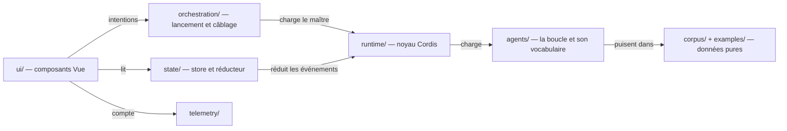
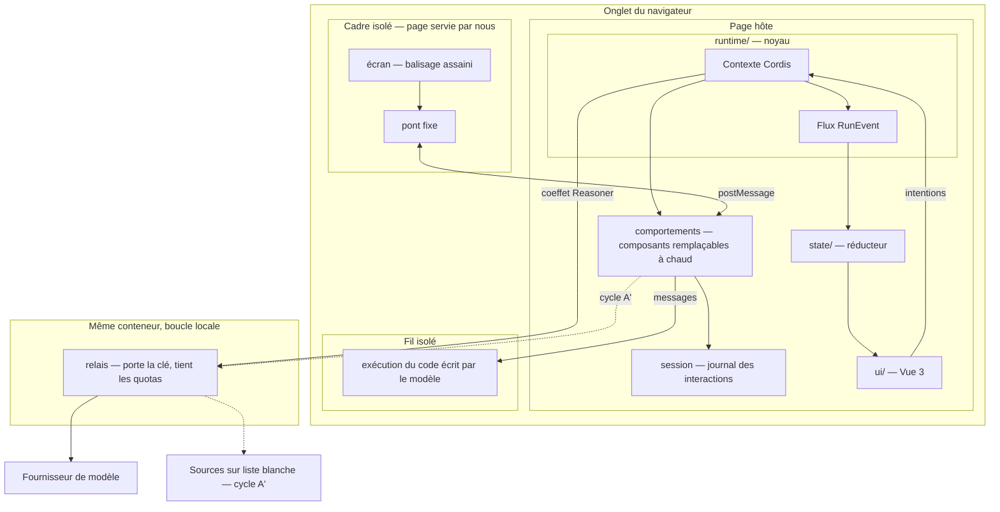
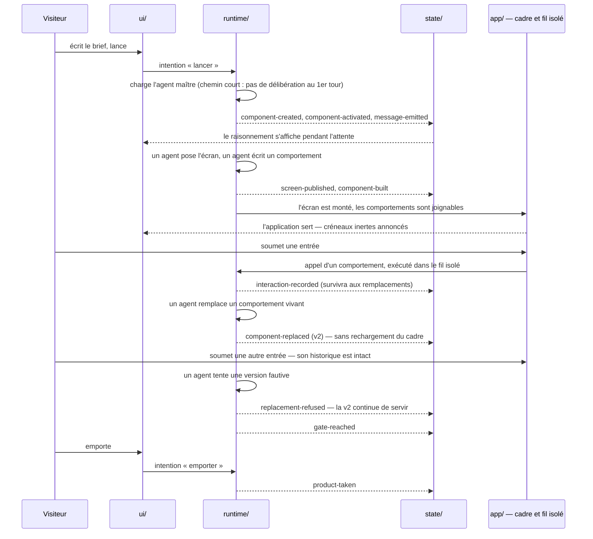
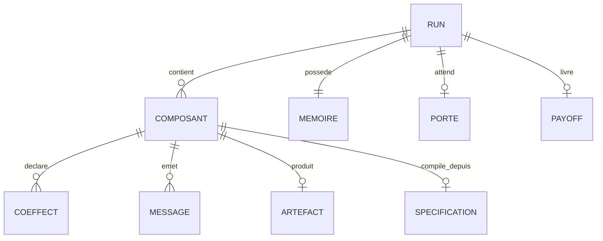
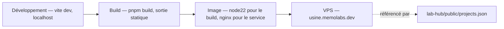

# Architecture Spine — L'usine agentique

## Design Paradigm

**Noyau de composition + projection unidirectionnelle** — des ports et adaptateurs autour du runtime Cordis.

Le runtime est le cœur : c'est lui qui charge les composants, propage les coeffects, fabrique et révoque. Il ne connaît ni Vue, ni le DOM, ni le domaine. Tout ce que le reste du monde apprend de lui sort par un **flux d'événements typés**, réduit dans un **modèle de lecture** que l'interface se contente d'afficher.

Le sens de la dépendance ne s'inverse jamais. L'interface pose des **intentions** (lancer, approuver, écarter, soumettre une entrée à l'application) ; elle ne touche jamais une fiber.

*Révisé le 2026-08-21.* Le paradigme ne change pas ; sa raison d'être devient explicite. Le papier qui le fonde distingue deux dimensions — **temporelle** (retirer un composant annule complètement ses effets) et **spatiale** (les dépendants réagissent quand une dépendance apparaît, disparaît ou change d'identité). La v1 déployée n'en démontrait aucune : rien ne servait pendant le run, donc il n'y avait pas de service à ne pas interrompre. L'architecture est donc réorientée autour d'un fait unique : **le système sert pendant qu'il se modifie.** Tout ce qui suit en découle — d'où vient l'état, où s'exécute le code écrit par un modèle, ce qu'un remplacement garantit.

*Révisé le 2026-08-24 (voir `docs/5-ANGLE.md`).* La modification à chaud n'est plus seulement autonome (les agents améliorent sur leur cadence) : elle est **réactive**. Une interaction du visiteur avec l'application vivante entre dans le flux comme un événement `visitor-interacted` — porté verbatim, donc rejouable (AD-33) — et **réveille l'agent qui a écrit le comportement visé** ; lui seul peut le remplacer (propriété), au plus `budget.maxReactions` fois pour tout le run (borne d'honnêteté : l'activité est finie). L'événement `visitor-interacted` est minté par le kernel **avant** le `component-replaced` qu'il cause, si bien que le flux montre la cause avant l'effet, et qu'un rejeu — qui ne re-mute jamais — reproduit la recomposition. Rien de nouveau côté garanties : l'état du visiteur reste hors du remplaçable (AD-30) et un remplacement prend ou rend la main, restaurant la version précédente avec ses composants s'il échoue (AD-31). C'est ce qui fait du hot-swap la valeur ressentie en usage, et non plus le décor du chantier.

*Cible produit changée le 2026-08-24 (voir `docs/7-MIGRATION.md`).* Le produit devient **l'atelier de pré-prod qui forke la timeline d'un agent**. Les invariants de cette spine sont **réutilisés tels quels** comme fondations du fork : le flux est l'archive (AD-33) donc on peut rejouer un run jusqu'à un `sequence` N ; l'état vit hors du remplaçable (AD-30) donc deux branches divergent sans se contaminer ; un remplacement est réversible (AD-31) donc on change l'agent à chaud sur la branche sans casser le tronc ; la porte humaine devient « valide/rejette **cette branche** ». **Fork gap load-bearing à bâtir** : hydrater un *kernel vivant* depuis un préfixe de flux — aujourd'hui `behavioursFromArchive` reconstruit des comportements *sans* kernel, donc `kernel.replace` n'aurait rien à remplacer sur une branche ; le reste (stop-at-N, mode fork du pilot, double store, scène à deux panneaux) est du câblage additif. **Deux garde-fous d'honnêteté** : le rollback est *intra-runtime* (il ne défait pas un effet externe — on prévient avant, on ne répare pas après) ; on tient une **primitive**, pas une « plateforme de fiabilité » ni un « control plane ».



Correspondance couche / répertoire : le paradigme est appliqué par l'arborescence, et l'arborescence est appliquée par le lint (AD-2).

## Invariants & Rules

### AD-1 — Le runtime est la seule source de vérité du run

- **Binds:** all
- **Prevents:** que l'interface et le moteur deviennent deux propriétaires du même état, et que le graphe affiche autre chose que ce qui vit réellement
- **Rule:** aucun état de run n'existe hors du runtime et de sa projection. Un nœud affiché correspond à une fiber vivante ; une arête affichée correspond à un coeffect réel. La contre-métrique C3 du PRD est vérifiée par un test automatisé qui compare les deux ensembles.

### AD-2 — Seul `runtime/` importe `cordis`

- **Binds:** all
- **Prevents:** que des appels au moteur se dispersent dans les composants Vue et que le paradigme s'érode composant par composant
- **Rule:** l'import de `cordis` est interdit partout ailleurs, par règle ESLint `no-restricted-imports` et non par discipline. Les autres modules passent par l'API publique de `runtime/`.

### AD-3 — Canal unique : tout sort en `RunEvent`

- **Binds:** F2, F3, F4, F8, F10
- **Prevents:** deux chemins concurrents de mise à jour, et des rappels ad hoc qui contournent la projection
- **Rule:** `runtime/` expose un unique flux d'`RunEvent`, union discriminée sur `type`. Ajouter une information visible au run, c'est ajouter une variante à cette union — jamais un rappel, jamais une lecture directe du registre.

### AD-4 — Le store n'est écrit que par le réducteur

- **Binds:** F3, F4, F8, F10
- **Prevents:** deux propriétaires d'une même donnée, et des mutations depuis un composant d'affichage
- **Rule:** `state/` expose un état en lecture seule et une seule fonction d'écriture, le réducteur `(state, RunEvent) => state`. Aucun composant Vue ne mute l'état. Le réducteur est pur et testable hors navigateur.

### AD-5 — Le graphe est une projection, jamais une source

- **Binds:** F3
- **Prevents:** le nœud décoratif que FR-016 interdit et que la contre-métrique C6 traque
- **Rule:** aucun code d'interface ne crée un nœud, une arête ou un état de nœud. Tout provient du réducteur. Une animation qui n'exprime aucun `RunEvent` est un défaut, pas une finition.

### AD-6 — Contrat de composant unique, présentation comprise

- **Binds:** F2, F3, F11
- **Prevents:** que les agents et les outils divergent en deux familles, et que l'affichage invente des métadonnées
- **Rule:** agents et outils partagent un seul type `Composant` : `name`, `inject`, `provide`, `apply`, plus un bloc `presentation` (rôle en une ligne, technologie **effective**). La technologie n'est renseignée que si le composant l'exécute réellement (FR-057) ; sinon le champ reste vide et rien ne s'affiche.

### AD-7 — L'identité appartient au runtime

- **Binds:** F2, F3, F10
- **Prevents:** deux schémas d'identifiants, et des nœuds orphelins après un rechargement
- **Rule:** l'identifiant d'un composant dérive de sa fiber, produit par `runtime/`. Aucun autre module ne fabrique d'identifiant de composant. Les artefacts et les messages référencent cet identifiant.

### AD-8 — Un agent écrit le code de son outil, et ce code est évalué

*Renversé. La version initiale interdisait l'évaluation par défaut et passait par un port `Fabrique` à deux voies, dont l'une n'assemblait qu'un vocabulaire fermé. Un agent ne pouvait donc jamais produire un outil imprévu — c'était le plafond, pas une sécurité.*

- **Binds:** F11
- **Prevents:** qu'un outil « fabriqué » ne soit en réalité qu'une combinaison choisie dans un catalogue écrit d'avance
- **Rule:** l'outil d'un agent est du **code que le modèle écrit**, évalué et chargé à chaud comme n'importe quel composant. L'évaluation est cantonnée à un point unique, et une règle ESLint la refuse partout ailleurs — vérifiée par un test qui exécute le linter. Ce qui protège n'est pas l'interdiction d'évaluer : c'est que le code est **affiché avant de tourner** et qu'une décision humaine reste devant l'emport.
- **Amendement du 2026-08-21 :** « chargé à chaud comme n'importe quel composant » ne suffisait pas — le code s'exécutait dans le contexte de la page hôte, où il voyait le document, le stockage local et la route du relais. L'évaluation et l'exécution se séparent : voir **AD-29**.

### AD-9 — Le LLM est un adaptateur derrière le port `Raisonneur`

- **Binds:** F7, F2
- **Prevents:** des appels au modèle dispersés dans les agents, et un repli d'erreur réimplémenté à chaque endroit
- **Rule:** un agent ne parle jamais à un fournisseur. Il consomme le coeffect `Raisonneur`. L'implémentation déterministe est le défaut ; l'adaptateur LLM la remplace agent par agent. En cas d'échec (clé, quota, réseau), le port retombe sur l'implémentation déterministe et émet un `RunEvent` d'erreur — le repli exigé par FR-046 est mécanique, pas répété.

### AD-10 — Le casting est un résultat du brief, pas une déclaration

*Révisé. La version initiale faisait du scénario une donnée déclarant le casting complet ; c'était une chaîne connue d'avance dont le brief ne changeait rien. Voir AD-23 et AD-24.*

- **Binds:** F9, F1, F6
- **Prevents:** qu'un graphe connu d'avance se fasse passer pour une composition, et des branchements conditionnels par niche dans le moteur
- **Rule:** aucun fichier ne déclare quels agents existent. Un **plan** est produit à l'exécution à partir du brief (AD-23) et le maître le charge (AD-24). Ce qui reste déclaré est de la **donnée métier** : les corpus de règles (`src/corpus/`), que l'usine choisit et n'invente pas, et des briefs d'exemple (`src/examples/`) qui ne décrivent aucun graphe. Ajouter une niche, c'est ajouter un corpus — aucun fichier de moteur, aucune topologie.

### AD-23 — Un agent n'a pas de comportement, il a une boucle d'actions

*Remplace la version « plan vérifié avant chargement ». Un plan décidé au départ restait un graphe connu d'avance : plus court, mais connu.*

- **Binds:** F1, F9, F10
- **Prevents:** qu'un catalogue d'agents écrits à la main se fasse passer pour une composition, et qu'une réponse de modèle atteigne le moteur sans être reconstruite
- **Rule:** un agent est une **mission** et une **boucle** : le modèle rend des actions (`creer`, `demander`, `fabriquer`, `publier`, `retirer`, `dire`, `terminer`), le moteur les exécute et lui rend les observations. Aucun rôle, aucun nom, aucune dépendance n'est écrit dans le produit. Ce qui vient du modèle est **reconstruit champ par champ** avant exécution (`agents/actions.ts`) — une action illisible est écartée, le tour continue. Sans modèle, aucun agent ne naît : l'usine ne peut rien inventer, et l'écran le dit plutôt que de rejouer un catalogue.

### AD-24 — Ce qui borne un run est un budget, pas un catalogue

- **Binds:** F1, F3, F11
- **Prevents:** qu'un chantier récursif parte à l'infini, et qu'un agent en panne fige le run sans écran
- **Rule:** quatre bornes, portées par le chantier partagé : nombre d'agents, profondeur de création, tours par agent, tokens du run. Un dépassement est une **observation rendue à l'agent** (« refusé : profondeur maximale atteinte »), pas une exception. Le maître n'ouvre la porte humaine qu'une fois le chantier **stabilisé** — plus aucun composant actif et aucune apparition pendant plusieurs vérifications — ou le délai écoulé, et il le dit. La porte reste hors du champ des agents : un produit qui pourrait se livrer sans décision humaine ne serait plus le même produit.

### AD-25 — Les agents se parlent par un aller-retour explicite

- **Binds:** F2, F3
- **Prevents:** qu'« ils se parlent » soit raconté par la narration sans exister dans le moteur
- **Rule:** les coeffects ne vont que dans un sens. La conversation est un mécanisme distinct : `ecouter` déclare comment un composant répond, `demander(nom, question)` route vers lui et attend, borné dans le temps. Une question et sa réponse sont **deux événements** (`question-posee`, `reponse-donnee`), donc deux faits vérifiables et deux traces à l'écran. Un destinataire absent, muet ou trop lent rend `undefined` — un silence, jamais une panne du demandeur.

### AD-26 — Un composant ne défait que ce qu'il a fait

- **Binds:** F2, F10
- **Prevents:** qu'un agent retire son propre maître, ou un pair qu'il n'a pas créé, et que le run se déferre par le milieu
- **Rule:** `liberer` et `remplacer` existent dans le contexte d'un composant, mais **refusent tout identifiant dont il n'est pas le parent**. La filiation est portée par le runtime, jamais déclarée par l'agent. Elle est aussi rendue visible : une arête de filiation relie créateur et créé quand aucun flux de données ne les relie déjà.

### AD-11 — La disposition suit la topologie vivante, et ne se recalcule que quand elle change

*Révisé. La version initiale calculait la disposition une fois sur la topologie déclarée ; elle supposait un graphe connu avant le run, ce qui n'est plus le cas.*

- **Binds:** F3, F9, F11
- **Prevents:** qu'un nœud vivant n'ait aucune place, que la disposition se recalcule à chaque message, et que deux runs de même topologie ne se ressemblent pas
- **Rule:** la disposition est calculée sur les **nœuds et arêtes réellement vivants**, et recalculée **au seul changement de topologie** — une signature `noms + arêtes` en décide ; ni un état, ni un artefact, ni un message ne déplace quoi que ce soit. Les nœuds **glissent** vers leur nouvelle place, la transition étant neutralisée sous `prefers-reduced-motion`. L'ordre interne d'une couche vient de l'ordre d'apparition. Le graphe est tenu entier dans son cadre par un `viewBox` : sa taille n'est pas connue d'avance. Le calcul de coordonnées s'appuie sur `@dagrejs/dagre` ; le **rendu** reste du code du projet, en SVG.

### AD-12 — *(retirée le 2026-08-21)* Le vérificateur est une fonction pure

Liée à F6 dans sa forme scénarisée, disparue avec elle. Ce qu'elle protégeait — une sortie qu'on peut rejouer et vérifier — est repris par **AD-33** (le run est rejouable depuis son flux) et par NFR-012 (toute réponse dit quelle version l'a produite).

### AD-13 — Aucun secret côté client

- **Binds:** F7
- **Prevents:** une clé lisible dans le paquet servi, dans le stockage du navigateur ou dans une requête émise par la page
- **Rule:** *révisée le 2026-08-21.* La clé du fournisseur ne touche jamais le client — le navigateur n'appelle que sa propre origine, et le relais, servi par le même conteneur, porte la clé et sort. La règle d'origine (« la clé vit dans une variable de module ») supposait que le visiteur fournisse la sienne ; ce n'est plus le cas. Ce qui reste inchangé et absolu : ni `localStorage`, ni `sessionStorage`, ni cookie, ni journal ne contient de secret, et aucun secret n'entre dans le paquet.

### AD-14 — Télémétrie fermée à quatre appels

- **Binds:** F8
- **Prevents:** qu'un contenu saisi par l'utilisateur parte par inadvertance, ce que NFR-011 interdit
- **Rule:** un module unique expose exactement quatre fonctions sans paramètre libre. Aucune charge utile, aucun identifiant, aucun cookie. Tout autre besoin de mesure passe par une décision, pas par un ajout silencieux. *Révisé le 2026-08-21 :* les quatre événements suivent le nouveau parcours — run lancé, premier écran utilisable, première soumission à l'application, porte atteinte (NFR-011). Le journal du relais (NFR-028) est une **seconde** surface de mesure, côté serveur, qui ne conserve aucun texte saisi ; il ne relâche pas cette règle-ci, il vit à côté.

### AD-15 — Un échec est un événement, pas une exception

- **Binds:** F2, F3, F4
- **Prevents:** qu'un agent défaillant fasse tomber la démonstration devant un recruteur
- **Rule:** `runtime/` capture les erreurs d'activation et les convertit en `RunEvent` d'erreur. Le run continue, le nœud porte l'état d'erreur, ses dépendants restent en attente et le signalent (FR-014).

### AD-16 — La politique de sécurité est un invariant de déploiement, `unsafe-eval` compris

*Renversé en même temps qu'AD-8, et pour la même raison. Ce qui était « pas d'`unsafe-eval` » est devenu « `unsafe-eval` et rien d'autre ».*

- **Binds:** all
- **Prevents:** que la politique s'élargisse au-delà de ce que l'évaluation exige réellement
- **Rule:** la production sert `default-src 'self'` et `script-src 'self' 'unsafe-eval'` — l'évaluation est nécessaire (AD-8), aucune source de script externe ne l'est. `object-src`, `base-uri`, `form-action`, `frame-ancestors` restent à `'none'` ; `connect-src` reste limité à `'self'`.
- **Amendement du 2026-08-21 :** `frame-src` passe de `'none'` à `'self'`, et **c'est le seul assouplissement que le cycle A demande**. Le cadre de l'application est une page que nous servons, sous sa propre politique, et le balisage écrit par les agents y arrive par message plutôt que par exécution (AD-28). Un dossier qui réclamerait `'unsafe-inline'`, une origine externe ou un cadre non sablé est un dossier à refuser, pas à négocier. Trois tests tiennent l'invariant : un test de contrat sur le fichier nginx servi, un test en navigateur réel qui exécute un comportement écrit pendant le run et vérifie qu'aucune requête ne part, et un test qui vérifie que le cadre ne peut pas atteindre la page hôte.

### AD-17 — Un nom de coeffect a un propriétaire unique, déclaré

- **Binds:** F2, F9, F11
- **Prevents:** que deux composants fournissent le même nom de coeffect et qu'un agent se câble au hasard sur l'un ou l'autre
- **Rule:** chaque nom de coeffect a un fournisseur unique. Le plan le déclare — et sa vérification (AD-23) refuse un nom publié deux fois ou un nom appartenant au maître. Charger un second fournisseur pour un nom déjà pris est une erreur de chargement, pas un remplacement silencieux — le runtime la convertit en `RunEvent` d'erreur (AD-15).

### AD-18 — Un composant produit au plus un artefact final

- **Binds:** F10
- **Prevents:** que deux constructeurs émettent plusieurs artefacts et que l'interface doive deviner lequel afficher quand on clique sur un nœud
- **Rule:** un composant émet autant de versions qu'il veut ; le réducteur ne conserve que la dernière, indexée par `ComponentId`. « L'artefact d'un nœud » est donc toujours défini et unique. Un artefact partagé par plusieurs composants n'existe pas : il appartient à celui qui l'a émis, et les autres le citent par l'identifiant de son auteur.

### AD-19 — L'état affiché d'un nœud est dérivé, jamais déclaré

- **Binds:** F3, F2
- **Prevents:** que chaque agent invente sa propre notion de « terminé » et que deux nœuds au même état réel s'affichent différemment
- **Rule:** les états visibles (inactif, en attente de dépendance, en cours, terminé, en erreur, libéré) sont produits par une **fonction unique** dans `state/`, à partir du `FiberState` du runtime et des événements reçus. `FiberState` ne connaît pas « terminé » : c'est le composant qui émet `work-finished` quand il a fini, et seule cette fonction traduit. Aucun composant ne pousse un état d'affichage.

### AD-20 — Les événements portent une séquence monotone produite par le runtime

- **Binds:** F3, F4, F8, F10
- **Prevents:** que des agents en parallèle rendent l'ordre d'affichage non reproductible, et que deux endroits se disputent la ligne de narration
- **Rule:** chaque `RunEvent` porte un numéro de séquence strictement croissant, attribué par `runtime/`. La ligne de narration (FR-026) est une **dérivation du réducteur** : le message de plus haute séquence, point. Aucun composant d'interface ne décide de ce qui s'affiche dans la narration.

### AD-21 — *(retirée)* Le registre de primitives de fabrication

*Supprimée avec AD-8. Le registre était le vocabulaire fermé dans lequel un agent devait puiser ; il n'existe plus, les agents écrivent leur code.*


### AD-22 — L'accessibilité est un invariant de rendu, pas une finition

- **Binds:** F3, F4, F5, F6
- **Prevents:** que chaque unité d'affichage arbitre l'accessibilité à sa façon et qu'un état de nœud finisse porté par la seule couleur
- **Rule:** trois règles s'appliquent à tout élément qui exprime un état : il porte une forme ou un texte en plus de sa couleur (NFR-017), il est atteignable au clavier s'il est actionnable (NFR-016), et son animation est neutralisée sous `prefers-reduced-motion` sans que l'information disparaisse (NFR-018). Les états de nœud sont rendus par un composant unique — pas réimplémentés par vue.

### AD-27 — L'application sert avant la porte, et pendant tout le run

*Ajoutée le 2026-08-21. C'est l'invariant dont tous les suivants découlent.*

- **Binds:** F5, F6, F12
- **Prevents:** que le produit n'existe qu'après une décision humaine — auquel cas rien ne sert pendant qu'on le modifie, et la composabilité temporelle n'a rien à démontrer
- **Rule:** dès qu'un écran et un comportement existent, l'application est servie et acceptable en entrée. Aucun composant, aucune vue, aucune intention ne peut conditionner l'existence du produit à l'état de la porte. La porte statue sur ce qui **sert déjà** : elle décide de l'emport ou de la rétractation, jamais de l'apparition.

### AD-28 — Le cadre isolé ne contient aucun code écrit par un agent

- **Binds:** F12
- **Prevents:** deux choses à la fois — qu'une page écrite par un modèle s'exécute avec les droits de la nôtre, et qu'un agent puisse loger la logique dans l'écran, où elle échapperait au remplacement à chaud
- **Rule:** le cadre est une page **que nous servons**, portant un pont fixe. Elle reçoit du balisage assaini — liste blanche de balises, aucun élément de script, aucun attribut d'événement, aucune source externe — et des attributs déclaratifs (`data-invoke`, `data-field`, `data-output`) qui **désignent** des comportements sans en contenir. Le cadre ne calcule rien : il ne le peut pas. Cette impossibilité est délibérée — elle force toute la logique dans des composants remplaçables, donc rend la démonstration structurelle au lieu de décorative.

### AD-29 — Le code écrit par un modèle ne s'exécute pas sur le fil de la page

- **Binds:** F11, F12
- **Prevents:** qu'un comportement généré lise le document, le stockage local ou la route du relais ; qu'une boucle infinie gèle l'onglet sans recours ; et qu'un run partagé devienne un vecteur d'exécution chez son destinataire
- **Rule:** l'évaluation produit une fonction, mais l'**exécution** a lieu dans un fil isolé, sans document, sans stockage, sans réseau. Tout échange est un message. Un comportement qui dépasse son temps imparti est **arrêté** — c'est la seule défense réelle contre une boucle infinie, et elle n'existe pas sur le fil principal. Le composant qui l'enveloppe reste un composant Cordis ordinaire : c'est lui qui porte le cycle de vie, le fil n'est qu'un lieu d'exécution.

### AD-30 — L'état de l'application vit hors de tout ce qui est remplaçable

- **Binds:** F12
- **Prevents:** qu'un remplacement à chaud coûte au visiteur ce qu'il a accumulé — auquel cas il ne vaut pas mieux qu'un redémarrage, et la thèse du produit tombe
- **Rule:** le journal des interactions — entrée, sortie, version qui a répondu — est un coeffect fourni par le maître, donc extérieur au cadre **et** aux composants que les agents remplacent. Aucun comportement ne détient d'état entre deux appels : ce qui doit survivre est passé et rendu. Un comportement qui accumulerait en interne perdrait sa mémoire au premier remplacement, et le produit mentirait sur son compteur.

### AD-31 — Un remplacement prend, ou rend la main : jamais entre les deux

- **Binds:** F12
- **Prevents:** qu'une version fautive laisse un trou — un nom sans fournisseur, un enfant orphelin, un créneau mort
- **Rule:** remplacer relâche l'entrée, charge la remplaçante, et **si elle échoue ou tombe en état d'erreur**, la relâche, restaure la précédente **et recharge les composants qu'elle avait chargés**. Il n'existe pas d'état intermédiaire observable. Le refus est un événement, pas une exception (AD-15), et l'agent le reçoit en observation pour pouvoir réessayer. Deux remplacements simultanés sur la même entrée sont refusés plutôt qu'entrelacés.

### AD-32 — La capacité est bornée par visiteur, et le rejeu est le repli

- **Binds:** F7, F13
- **Prevents:** qu'un seul visiteur épuise la journée, et qu'un site public réponde une erreur brute quand il n'a plus de capacité
- **Rule:** le relais applique un budget **par visiteur** en plus du plafond global, et les deux sont dits à l'écran avant le lancement. Capacité épuisée, crédit à zéro, relais muet, fournisseur en panne : la page bascule sur le rejeu d'un run enregistré **en l'annonçant**. Le rejeu est un chemin de premier rang — même modèle de lecture, mêmes vues, mêmes tests que le direct. Aucun code ne distingue « le vrai run » du rejeu au-delà de l'origine des événements.

### AD-33 — Un run est rejouable depuis son seul flux d'événements

- **Binds:** F13
- **Prevents:** que la démonstration dépende d'un modèle disponible, et qu'on ne puisse pas prouver après coup ce qui s'est réellement passé
- **Rule:** le flux `RunEvent` est **le format d'archive**. Un événement ne référence jamais un objet vivant, ne porte jamais de date absolue, et se suffit à lui-même — un run exporté puis rejoué reproduit exactement le même modèle de lecture. Ce que AD-3 posait par hygiène devient une garantie extérieure : le corollaire est qu'aucune information nécessaire à l'écran ne peut exister ailleurs que dans le flux.

### AD-34 — Rien ne sort du navigateur sans passer par le relais et une liste blanche

- **Binds:** F13
- **Prevents:** qu'un domaine proposé par un modèle soit appelé, et qu'un site public devienne un proxy ouvert
- **Rule:** `connect-src` reste à `'self'` : le navigateur ne parle qu'à notre origine. Toute source de données est **choisie dans une liste tenue côté serveur**, jamais construite à partir d'une chaîne venue du modèle — un agent nomme une source, il ne fournit pas une adresse. Les quotas du relais s'appliquent à cette route comme à celle du raisonnement. Cette règle porte aussi l'outillage découvert à l'exécution, le jour où il arrivera : le client ne parlera jamais directement à un serveur d'outils.

## Consistency Conventions

| Concern | Convention |
| --- | --- |
| Langue du code | **Anglais**, sans exception : identifiants, noms de fichiers, types, commentaires, descriptions de tests, classes CSS, attributs `data-`, et le vocabulaire d'action que le modèle émet (`create`, `ask`, `build`) — c'est un protocole, pas de la prose. *Révisé : la version initiale imposait le français « comme le domaine » ; elle rendait le dépôt illisible pour qui n'est pas francophone, sans rien gagner.* Reste en français ce qui s'adresse à un humain francophone : libellés d'interface, narration, artefacts, prompts envoyés au modèle, et données réglementaires. |
| Nommage des fichiers | `kebab-case.ts` pour les modules, `PascalCase.vue` pour les composants Vue, un fichier par composant Cordis sous `agents/`. |
| Événements | `RunEvent` discriminé sur `type`, valeurs en `kebab-case` anglais (`component-activated`, `artifact-published`, `gate-reached`). Participe passé : un événement décrit un fait accompli. |
| Identifiants | `ComponentId` est un type nominal produit par `runtime/`. Jamais une chaîne nue dans une signature publique. |
| Dates et durées | Millisecondes entières pour les durées ; aucune date absolue dans le modèle de run. |
| Ordre | Tout ordre visible dérive du numéro de séquence des événements (AD-20) : ordre d'apparition dans une couche du graphe, ordre du journal. Jamais un tri par date. |
| Forme d'erreur | `{ code: string, message: string, component?: ComponentId }`. Jamais une `Error` brute franchissant la frontière du runtime. |
| Mutation d'état | Une seule voie : le réducteur. Les composants Vue reçoivent des valeurs, émettent des intentions. |
| Journalisation | Aucune sortie console en production. Le journal du run (NFR-014) est une projection du flux d'événements, pas un `console.log`. |
| Configuration | Aucune variable d'environnement dans le chemin par défaut : l'application doit fonctionner servie telle quelle. |
| Types | TypeScript strict, aucun `any` implicite, aucune assertion `as` sur une frontière de module. |

## Stack

Versions relevées sur le registre npm le 2026-08-20.

| Name | Version |
| --- | --- |
| TypeScript | ~6.0 (strict) — version en place dans le projet ; TypeScript 7.0.2 est sorti, la montée est un choix à part entière et n'est pas engagée ici |
| Vue | 3.5.41 |
| Vite | 8.2.2 |
| cordis | 4.0.0-rc.8 |
| Vitest | 4.1.11 |
| @vitest/browser + Playwright | 4.1.11 / 1.62.1 |
| pnpm | 11.x |
| nginx (image de service) | stable |

| @dagrejs/dagre | 3.1.1 |

Une seule dépendance de disposition, et rien d'autre. Ce qui a été écarté, et pourquoi, mesuré le 2026-08-20 :

- **`elkjs` 0.12.0 — rejeté.** 484 ko gzip à lui seul. NFR-007 fixe le bundle entier sous 500 ko. Le rapport est sans appel.
- **`@vue-flow/core` — rejeté.** C'est une bibliothèque de **rendu** : elle apporte ses propres composants de nœud, son style et son modèle d'interaction. Le design system impose un rendu sur mesure ; on se battrait contre elle à chaque écran.
- **`pinia` — rejeté.** L'état du run est un réducteur pur sur un flux d'événements (AD-4). Pinia ajoute des conventions et un inspecteur pour une trentaine de lignes de code qu'on écrit une fois.
- **`@dagrejs/dagre` 3.1.1 — retenu.** 17,6 ko gzip pour l'affectation en couches, la minimisation des croisements et le placement de coordonnées. Écrire soi-même un Sugiyama correct coûte plus cher que 17,6 ko, et FR-022 (aucun chevauchement, aucune arête traversant un nœud) est précisément ce que cet algorithme résout. Le rendu, lui, reste à nous.

## Structural Seed

### Vue d'ensemble

*Révisée le 2026-08-21 : l'application vivante, son cadre isolé et le fil d'exécution apparaissent ; le relais remplace l'appel direct au fournisseur.*



Trois frontières, et chacune porte une garantie : le **cadre** ne peut pas atteindre la page hôte (AD-28), le **fil isolé** ne peut atteindre ni le document ni le réseau et peut être arrêté (AD-29), le **relais** est la seule sortie et il est sur liste blanche (AD-34). L'`état` est délibérément hors des trois : c'est lui qui survit aux remplacements (AD-30).

### Cycle d'un run



Le point à lire dans ce diagramme : **le visiteur soumet des entrées entre les deux remplacements.** Toute la thèse du produit tient dans cet entrelacement — enlever ces deux flèches et il ne reste qu'un générateur de code.

### Entités du modèle de lecture



### Déploiement et environnements

Un seul artefact, un seul environnement de production. Il n'y a pas de service, pas de base, pas de secret côté serveur : le produit est un build statique.



Trois points sont contractuels et non négociables au déploiement :

- **La CSP stricte** `default-src 'self'`, sans `unsafe-eval` (AD-16), servie par nginx. Un test de non-régression la vérifie dans un navigateur réel.
- **Aucune variable d'environnement** dans le chemin par défaut : l'application doit fonctionner servie telle quelle, sans configuration.
- **Aucun secret dans l'image**. La seule clé du système est fournie par l'utilisateur, à l'exécution, et ne survit pas à l'onglet (AD-13).

### Arborescence

```text
src/
  runtime/            # SEUL module autorisé à importer cordis (AD-2)
    kernel.ts         # création du contexte, chargement, libération, messagerie
    contract.ts       # le type Component (AD-6), ComponentId (AD-7)
    events.ts         # l'union RunEvent (AD-3)
    reasoner/         # port Reasoner (AD-9) — index, claude, relay
  agents/             # free-agent.ts (la boucle), actions.ts (le vocabulaire),
                      # master.ts (l'amorce)
  corpus/             # données métier (AD-10) — les règles réelles, en ressource
  examples/           # briefs de départ + la démonstration rejouée, sans clé
  state/              # store en lecture seule + réducteur (AD-4)
    reducer.ts
    layout.ts         # disposition du graphe vivant (AD-11)
  app/                # l'application vivante (AD-27 à AD-30)
    bridge.ts         # le pont fixe monté dans le cadre isolé (AD-28)
    sanitize.ts       # liste blanche de balises et d'attributs (AD-28)
    worker.ts         # le fil d'exécution des comportements (AD-29)
    session.ts        # le journal des interactions, hors du remplaçable (AD-30)
  orchestration/      # factory.ts (le lancement), pilot.ts (le câblage)
  ui/                 # composants Vue — projection seulement (AD-5)
  telemetry/          # quatre appels, rien d'autre (AD-14)
  assets/tokens.css   # design system, conservé de l'existant

public/
  sandbox/index.html  # la page du cadre isolé, servie par nous (AD-28)
```

*Ajouté le 2026-08-21 : `app/` et `public/sandbox/`. `corpus/` est en sursis — plus aucun consommateur depuis le retrait des scénarios (Q15).*

## Capability → Architecture Map

| Capability / Area | Lives in | Governed by |
| --- | --- | --- |
| F1 · Brief et lancement | `ui/`, `orchestration/` | AD-1, AD-10, AD-23, AD-24 |
| F2 · Moteur de composition | `runtime/` | AD-1, AD-2, AD-3, AD-6, AD-7, AD-15, AD-17, AD-19 |
| F3 · Graphe vivant | `state/`, `ui/` | AD-4, AD-5, AD-11, AD-19, AD-20, AD-22 |
| F4 · Agents qui parlent | `runtime/`, `state/`, `ui/` | AD-3, AD-4, AD-20 |
| F5 · Porte humaine | `runtime/`, `ui/` | AD-1, AD-3, AD-22 |
| F6 · Le produit | `agents/`, `app/`, `ui/` | AD-27, AD-30, AD-22 |
| F7 · Mode LLM branché | `runtime/raisonneur/` | AD-9, AD-13 |
| F8 · Compteurs | `state/`, `telemetry/` | AD-4, AD-14 |
| F9 · Domaines | `corpus/`, `examples/` | AD-10, AD-17, AD-23 |
| F10 · Artefacts | `runtime/`, `state/`, `ui/` | AD-3, AD-7, AD-18 |
| F11 · Fabrication à l'exécution | `agents/` | AD-8, AD-16, AD-17, AD-24, AD-29 |
| F12 · Application vivante | `runtime/`, `agents/`, `app/` (cadre, pont, fil isolé), `ui/` | AD-27, AD-28, AD-29, AD-30, AD-31, AD-22 |
| F13 · Sources, emport, rejeu | relais, `state/`, `ui/` | AD-32, AD-33, AD-34, AD-3 |

## Deferred

*Révisé le 2026-08-21.*

- ~~**Le remplacement à chaud réel.**~~ **Sorti du différé : c'est devenu le cœur** (AD-31). Le mécanisme du noyau est écrit, verrouillé contre l'entrelacement et testé ; ce qui manquait était un appelant. `@cordisjs/plugin-hmr` reste non installé et non nécessaire — le remplacement passe par le noyau, pas par un rechargement de module.
- **La forme du fil isolé** (AD-29) : un fil par comportement, un fil partagé, ou un fil par application. Le choix se tranche sur mesure au premier jet du cycle A, pas ici. Ce qui est fixé et ne se renégocie pas : aucun accès au document, au stockage ni au réseau, et l'arrêt possible.
- **Le format d'archive d'un run** (AD-33) : la garantie est posée, la sérialisation concrète — version de schéma, compression, taille acceptable dans une URL ou un fichier — appartient au cycle A′.
- **La forme du budget par visiteur** (AD-32) : comment un visiteur est reconnu sans identifiant persistant, et ce que vaut cette reconnaissance. Contrainte qui borne la réponse : NFR-011 interdit le cookie et l'identifiant persistant, donc la réponse ne peut pas être une session classique.
- **Le critère d'entrée dans la liste blanche des sources** (AD-34, Q12). Une liste molle transforme le relais en proxy ouvert ; le critère est une décision, pas une conséquence.
- **La vérification par cas exécutés et la cascade de désactivation visible** (cycle B). C'est la dimension **spatiale** du paradigme, la seule encore non démontrée. Elle a sa propre passe d'architecture.
- ~~**La mémoire de run et l'outillage MCP.**~~ **Sortis du différé le 2026-08-21 : écrits.** Le rappel est local au run (`agents/recall.ts`) parce qu'une mémoire coûtant un aller-retour par tour ajouterait une seconde là où le produit se bat pour son premier écran ; le service en garde une version persistante, adossée à pgvector. Le client MCP vit dans le service, poignée de main comprise, et le navigateur ne parle jamais à un serveur d'outils.
- **La bibliothèque de compétences persistée d'un run à l'autre.** Toujours différée, et c'est le dernier des trois chantiers : elle compose sur le remplacement à chaud et sur la mémoire, qui existent maintenant tous deux.
- **Ce que MCP n'a pas encore.** Un serveur *avec état* renvoie son identifiant de session dans un en-tête HTTP ; notre transport ne rend que le corps, donc ces serveurs-là ne sont pas supportés. C'est le type `Transport` qui changera, pas le module.
- **Ce que le bac à sable serveur ne borne pas.** La sortie réseau. Isoler une socket demande un espace de noms, donc un conteneur ou un service dédié. Ce qui protège aujourd'hui est en amont — un outil ne reçoit jamais d'adresse — et un test nomme la limite au lieu de la taire.
- **La tenue à quarante nœuds** (NFR-002). Non mesurée. Le budget de rendu se décide quand le graphe existe et qu'on peut le charger.
- **Tout ce qui relève d'un serveur au-delà du relais** : persistance, comptes, traitement par lot, monétisation. Le relais est délibérément mince — il porte une clé, des quotas et une liste blanche, rien d'autre. L'y voir grossir est le signal qu'une décision a été prise sans être posée.
