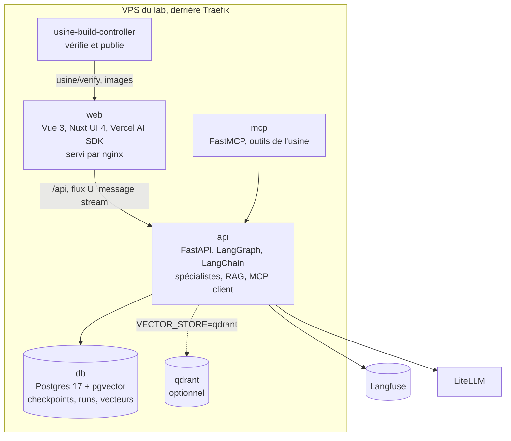
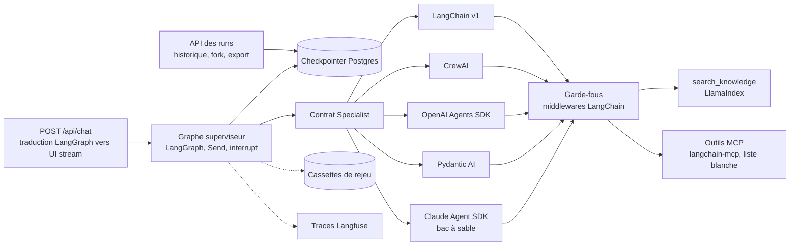

# Architecture de l'usine v2

Écrit le 14 novembre 2026 (Linear MEM-8). La décision et ses raisons sont dans
l'[ADR 0001](../adr/0001-adopter-les-frameworks-agentiques-du-marche.md). Ce
document dit comment les pièces tiennent ensemble. Il suit le modèle C4 sur
trois niveaux : contexte, conteneurs, composants de l'API.

Les schémas sont en Mermaid, rendus par GitHub. Les sections marquées « cible »
décrivent ce que les jalons construisent ; le reste existe déjà sur `v2`.

## 1. Contexte

Qui utilise l'usine, et avec quoi elle parle.

## 2. Conteneurs

| Conteneur | Rôle | État sur `v2` |
|---|---|---|
| `web` (`apps/web`) | Conversation, scène, graphe vivant, porte humaine | squelette (MEM-4) |
| `api` (`services/api`) | Orchestration LangGraph, spécialistes, RAG, garde-fous, flux vers le web | service FastAPI hérité de la v1, compose de dev (MEM-7) |
| `db` | Checkpoints LangGraph, runs, vecteurs pgvector | compose de dev (MEM-7) |
| `mcp` | Expose les primitives de l'usine en MCP | cible (MEM-39) |
| `qdrant` | Second stockage vectoriel, activé par un réglage | cible (MEM-45) |
| builder | `scripts/verify.sh` dans `Dockerfile.verify`, statut `usine/verify` | en service (MEM-6) |

Langfuse et LiteLLM sont des services partagés du lab : l'usine les utilise, elle
ne les déploie pas.

## 3. Composants de l'API (cible)

Le graphe superviseur qui existe déjà (MEM-11) est dessiné par LangGraph lui-même
dans [`supervisor-graph.mmd`](supervisor-graph.mmd). Un test compare ce fichier au
graphe réel, et on le régénère avec `uv run python -m usine_api.graph.diagram`.
Le schéma ci-dessous montre la cible complète.

## 4. Contrats entre les couches

Chaque contrat a un schéma dans le code. Il commence minimal et grandit avec
son jalon.

| Contrat | Entre | Schéma | Grandit avec |
|---|---|---|---|
| Flux UI message stream | `api` vers `web` | `apps/web/src/contracts/ui-stream.ts` (types côté web) ; protocole : https://ai-sdk.dev/docs/ai-sdk-ui/stream-protocol | MEM-14 |
| Événement de run | graphe, flux, archive, rejeu | `services/api/usine_api/contracts/run_event.py` (Pydantic), miroir TypeScript dans `ui-stream.ts`. Un test vérifie que les deux listes restent identiques. | MEM-17, MEM-24, MEM-26 |
| Spécialiste | graphe et frameworks | `services/api/usine_api/contracts/specialist.py` (entrée, sortie, budget, identité) | MEM-27 |
| Base de données | services et Postgres | `services/api/usine_api/settings.py`, qui assemble la chaîne à partir des morceaux `POSTGRES_*` | MEM-12 |
| Vérification | dépôt et builder | `scripts/verify.sh`, `Dockerfile.verify`, statut `usine/verify` | MEM-56 |

## 5. Invariants

Ils ne se renégocient pas d'un jalon à l'autre.

1. **La clé du fournisseur reste côté serveur.** Le paquet web n'en contient
   aucune. Tous les appels de modèle passent par LiteLLM.
2. **Un agent nomme un serveur ou une source, jamais une adresse.** Les outils
   MCP et les sources RAG sont déclarés dans une liste blanche côté serveur
   (MEM-37). Un site public qui relaie une adresse fournie par un modèle devient
   un proxy ouvert.
3. **Le retour arrière est intra-runtime.** Un fork restaure l'état de l'agent
   (les checkpoints), jamais un effet externe déjà produit. Toute action
   irréversible passe d'abord par la porte humaine, `interrupt()` (MEM-20).
4. **Le flux est le format d'archive.** Un événement porte `at`, le temps écoulé,
   jamais une date absolue, et ne référence aucun objet vivant (règle 2 de la
   v1, gardée). Le schéma refuse les champs inconnus.
5. **Un remplacement prend la main ou la rend, jamais entre les deux** (règle 5
   de la v1, gardée). Un spécialiste qui échoue au chargement laisse la branche
   intacte (MEM-33).
6. **L'état du visiteur vit hors de tout ce qui est remplaçable** (règle 4 de la
   v1, gardée).
7. **Le code écrit par un modèle ne s'exécute jamais dans la page ni dans
   l'API.** Il tourne dans un bac à sable serveur sans réseau (MEM-32). Cette
   règle remplace la règle 3 de la v1 (le Web Worker).
8. **Une seule liste de contrôles.** `scripts/verify.sh` sert aux hooks locaux
   et au builder, et une PR rouge ne fusionne pas dans `v2`.

## 6. Ce qui reste à décider

- L'identité dédiée du builder, à la place du jeton personnel (MEM-6).
- L'authentification de l'atelier : basic auth Traefik ou Pocket ID (MEM-60).
- La forme exacte des parties `data-*` du flux, fixée avec MEM-14 d'après la doc
  de la version installée du Vercel AI SDK.
