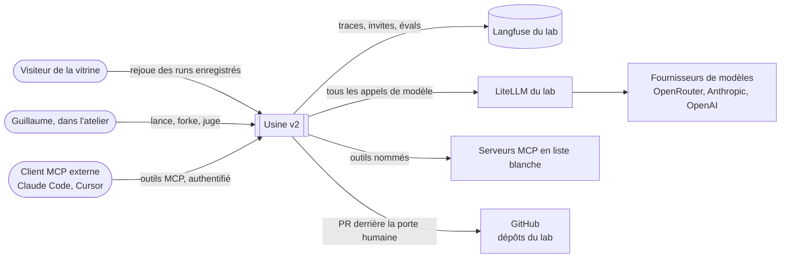
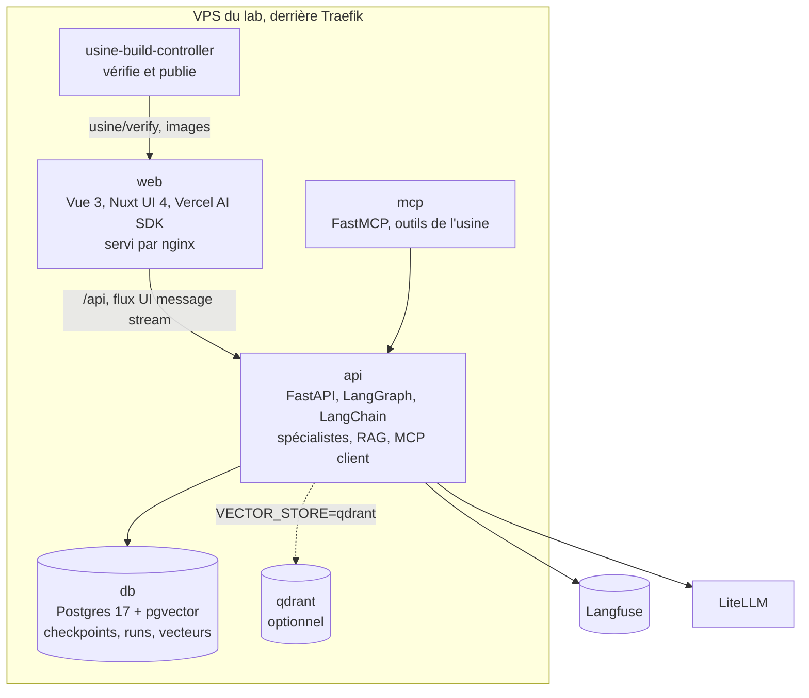
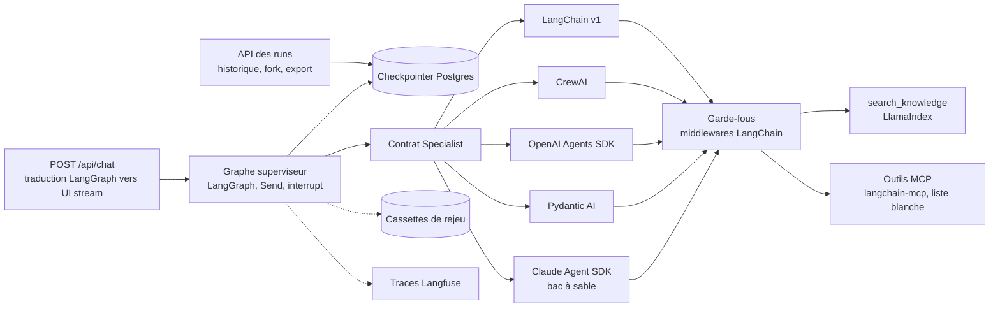

# Architecture de l'usine v2

Écrit le 14 novembre 2026 (Linear MEM-8). La décision et ses raisons sont dans
l'[ADR 0001](../adr/0001-adopter-les-frameworks-agentiques-du-marche.md). Ce
document dit comment les pièces tiennent ensemble. Il suit le modèle C4 sur
trois niveaux : contexte, conteneurs, composants de l'API.

Les schémas sont en Mermaid, rendus par GitHub. Les sections marquées « cible »
décrivent ce que les jalons construisent ; le reste existe déjà sur `v2`.

## 1. Contexte

Qui utilise l'usine, et avec quoi elle parle.



## 2. Conteneurs



| Conteneur | Rôle | État sur `v2` |
|---|---|---|
| `web` (`apps/web`) | Conversation, scène, graphe vivant, porte humaine | squelette (MEM-4) |
| `api` (`services/api`) | Orchestration LangGraph, spécialistes, RAG, garde-fous, flux vers le web | service FastAPI hérité de la v1, compose de dev (MEM-7) |
| `db` | Checkpoints LangGraph, runs, vecteurs pgvector | compose de dev (MEM-7) |
| `mcp` | Expose les primitives de l'usine en MCP | cible (MEM-39) |
| `qdrant` | Second stockage vectoriel, activé par un réglage | cible (MEM-45) |
| builder | `scripts/verify.sh` dans `Dockerfile.verify`, statut `usine/verify` | en service (MEM-6) |

Langfuse et LiteLLM sont des services partagés du lab : l'usine les utilise, elle
ne les déploie pas.

## 3. Composants de l'API (cible)

Le graphe superviseur qui existe déjà (MEM-11) est dessiné par LangGraph lui-même
dans [`supervisor-graph.mmd`](supervisor-graph.mmd). Un test compare ce fichier au
graphe réel, et on le régénère avec `uv run python -m usine_api.graph.diagram`.
Le schéma ci-dessous montre la cible complète.



## 4. Contrats entre les couches

Chaque contrat a un schéma dans le code. Il commence minimal et grandit avec
son jalon.

| Contrat | Entre | Schéma | Grandit avec |
|---|---|---|---|
| Flux UI message stream | `api` vers `web` | `apps/web/src/contracts/ui-stream.ts` (types côté web) ; protocole : https://ai-sdk.dev/docs/ai-sdk-ui/stream-protocol | MEM-14 |
| Événement de run | graphe, flux, archive, rejeu | `services/api/usine_api/contracts/run_event.py` (Pydantic), miroir TypeScript dans `ui-stream.ts`. Un test vérifie que les deux listes restent identiques. | MEM-17, MEM-24, MEM-26 |
| Spécialiste | graphe et frameworks | `services/api/usine_api/specialists/contract.py` (interface), modèles Pydantic dans `contracts/specialist.py` | MEM-27, MEM-33 |
| Base de données | services et Postgres | `services/api/usine_api/settings.py`, qui assemble la chaîne à partir des morceaux `POSTGRES_*` | MEM-12 |
| Vérification | dépôt et builder | `scripts/verify.sh`, `Dockerfile.verify`, statut `usine/verify` | MEM-56 |

### Le contrat Specialist (MEM-27)

Un rôle, n'importe quel framework : c'est ce qui rend le remplacement à chaud
(MEM-33) et la comparaison (MEM-34) autre chose qu'une promesse.

```python
class Specialist(Protocol):
    identity: SpecialistIdentity          # nom, framework, version

    async def run(self, task: SpecialistInput) -> SpecialistOutput: ...
```

Ce que l'implémentation reçoit et rend : `SpecialistInput` (une tâche, des
**noms** d'outils autorisés, un `Budget`) et `SpecialistOutput` (une réponse,
des jetons, des appels d'outils, et les actions irréversibles qu'elle propose).
Les modèles Pydantic vivent dans `contracts/specialist.py` et sont ré-exportés
par `specialists/contract.py` : leur chemin de module est inscrit dans les
checkpoints LangGraph, donc les déplacer casserait la relecture des runs déjà
enregistrés.

Trois choses sont tenues **une fois, par l'adaptateur** (`specialists/node.py`),
jamais par chaque framework :

1. **le budget.** La durée est une borne dure (`asyncio.wait_for`, le
   spécialiste est annulé) ; les jetons et les appels d'outils sont vérifiés
   après la réponse. Un dépassement lève `BudgetExceeded`, typée, avec le genre
   de limite et les deux nombres. Un arrêt de budget se distingue donc d'une
   panne de modèle, à l'écran comme dans les tests ;
2. **la trace.** Chaque appel est un run nommé `specialist:<nom>`, avec le
   framework et sa version en métadonnées : Langfuse montre les quatre
   frameworks de la même façon ;
3. **le nœud LangGraph.** `{"task": ...}` entre, `{"results": [output]}` sort,
   ce qui est le canal `results` du graphe superviseur.

Le registre (`specialists/__init__.py`) charge une implémentation **par nom**.
Il se remplit à l'import des adaptateurs, et les modules connus sont nommés
(`BUILTINS`) pour qu'un nom existe même si personne ne les a importés.

### Le remplacement à chaud (MEM-33)

Un run peut nommer le spécialiste qu'il exécute, et un fork le fait :

- le nom voyage dans la **configuration du run** (`configurable.specialist`),
  pas dans un réglage de processus : un seul graphe sert tous les frameworks, et
  la résolution se fait au nœud, pour ce run-là ;
- la branche le **retient** (colonne `specialist` sur `threads`, migration 0007),
  donc la rouvrir ou répondre à sa porte humaine réutilise la même
  implémentation ;
- un nom que le service ne sait pas faire tourner est refusé **avant** la
  création de la branche (422), jamais remplacé en silence par le défaut : une
  branche qui demandait CrewAI ne tourne pas en LangChain sans le dire ;
- `GET /api/specialists` publie ce que ce service peut exécuter, avec l'identité
  que la trace portera : c'est ce que le sélecteur de l'écran affichera.

### Deux implémentations réelles (MEM-31)

| Nom au registre | Framework | Ce qu'elle apporte |
|---|---|---|
| `chat-model` | LangChain v1 | la réponse rédigée, prompt versionné, même client que le reste du service |
| `pydantic-verdict` | Pydantic AI 2.68 | le **juge des portes** : un verdict typé (`passe`, `echoue`, `incertain`) avec au moins un motif et sa preuve |
| `openai-agents` | OpenAI Agents SDK 0.24 | la même réponse par un troisième runner, en `chat/completions` pour passer par LiteLLM ; traces OpenAI désactivées |

Le juge ne rend jamais un verdict partiel : la sortie est un modèle Pydantic
que le framework valide, une réponse à côté déclenche des reprises bornées
(`retries`), et l'épuisement de ces reprises lève `VerdictRefused`. Le nombre de
tentatives part en score Langfuse (`verdict/tentatives`) sur la trace du run,
parce qu'un verdict qu'il a fallu redemander est un fait sur ce run.

Pydantic AI passe par le **même client HTTP** que le reste du service : la
cassette de rejeu (MEM-24) s'applique donc à lui comme aux autres.

### Le comparateur (MEM-34)

Le même jeu de cas figés (`services/api/compare/cases.json`) passe dans chaque
implémentation, et `POST /api/compare` (ou `python -m usine_api.compare`) rend un
rapport par framework : **jetons, taux de réussite des portes, erreurs, latence
p50 et p95**. Chaque spécialiste est aussi écrit comme **une expérience
Langfuse** (`run_experiment`, client 5.2) : le rapport porte le lien.

Trois règles y sont tenues, et chacune protège le rapport d'un mensonge :

- **pas de latence en `replay`** : une cassette répond en microsecondes, ce
  n'est pas la vitesse du modèle. Le rapport se dit `replay: true` et laisse les
  latences à `null`, sinon il ne serait pas reproductible ;
- **pas de note de porte pour qui ne rend pas de verdict** : un rédacteur a
  `null`, pas `0` ;
- **une erreur est comptée et nommée**, jamais avalée : elle apparaît avec le cas
  qui l'a provoquée.

Le premier rapport réel est versionné dans `docs/benchmarks/` (trois frameworks :
LangChain, Pydantic AI, OpenAI Agents SDK ; CrewAI viendra avec son adaptateur).

**La conformité est un test, pas une convention.** `tests/test_specialist_contract.py`
rejoue la même suite sur chaque implémentation déclarée, aujourd'hui un faux
spécialiste, l'adaptateur LangChain, le juge Pydantic AI et l'adaptateur
OpenAI Agents SDK. Ajouter CrewAI,
OpenAI Agents SDK ou Claude Agent SDK, c'est ajouter une ligne à
`IMPLEMENTATIONS` et satisfaire les mêmes exigences.

## 5. Invariants

Ils ne se renégocient pas d'un jalon à l'autre.

1. **La clé du fournisseur reste côté serveur.** Le paquet web n'en contient
   aucune. Tous les appels de modèle passent par LiteLLM.
2. **Un agent nomme un serveur ou une source, jamais une adresse.** Les outils
   MCP et les sources RAG sont déclarés dans une liste blanche côté serveur
   (MEM-37). Un site public qui relaie une adresse fournie par un modèle devient
   un proxy ouvert.
3. **Le retour arrière est intra-runtime.** Un fork restaure l'état de l'agent
   (les checkpoints), jamais un effet externe déjà produit. Toute action
   irréversible passe d'abord par la porte humaine, `interrupt()` (MEM-20).
4. **Le flux est le format d'archive.** Un événement porte `at`, le temps écoulé,
   jamais une date absolue, et ne référence aucun objet vivant (règle 2 de la
   v1, gardée). Le schéma refuse les champs inconnus.
5. **Un remplacement prend la main ou la rend, jamais entre les deux** (règle 5
   de la v1, gardée). Un spécialiste qui échoue au chargement laisse la branche
   intacte (MEM-33).
6. **L'état du visiteur vit hors de tout ce qui est remplaçable** (règle 4 de la
   v1, gardée).
7. **Le code écrit par un modèle ne s'exécute jamais dans la page ni dans
   l'API.** Il tourne dans un bac à sable serveur sans réseau (MEM-32). Cette
   règle remplace la règle 3 de la v1 (le Web Worker).
8. **Une seule liste de contrôles.** `scripts/verify.sh` sert aux hooks locaux
   et au builder, et une PR rouge ne fusionne pas dans `v2`.

## 6. Ce qui reste à décider

- L'identité dédiée du builder, à la place du jeton personnel (MEM-6).
- L'authentification de l'atelier : basic auth Traefik ou Pocket ID (MEM-60).
- Le préfixe `/api` : `/api/chat` le porte (adresse par défaut de `useChat`,
  transmise telle quelle par le proxy de Vite), les routes héritées de la v1 non.
  À aligner avant le déploiement de `services/api` (MEM-6).

La forme des parties `data-*` est fixée par MEM-14 : une partie `data-run-event`
par événement de run, dont `data` est un `RunEvent`. Les flux enregistrés de
`services/api/tests/fixtures/chat-stream/` sont lus par le vrai `ai@7.0.165`
dans `apps/web/src/__tests__/chat-stream.spec.ts`.
